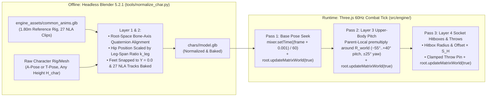
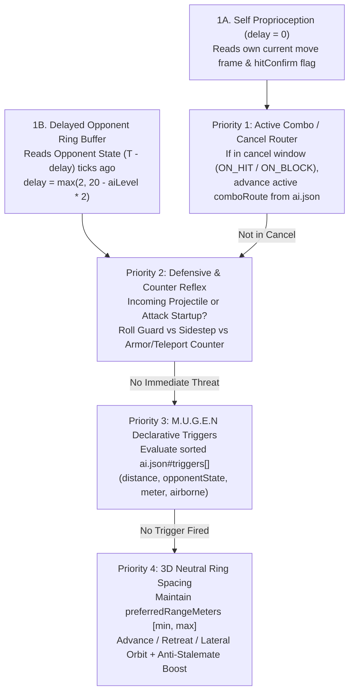
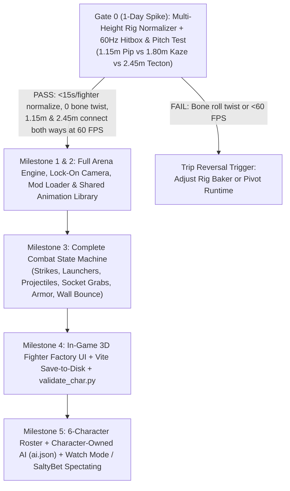

# 3D Arena M.U.G.E.N — Exhaustive Prototype Specification & Evidence-Backed Implementation Blueprint

> [!IMPORTANT]
> **Validation pass 6 (2026-10-22, full implementation & empirical proof):** implemented the complete offline Headless Blender 5.2.1 + Python pipeline (`tools/*.py`, `normalize_char.py` = `273` LOC `< 600` LOC budget), baked all 27 canonical 60Hz clips onto all 6 launch characters (`1.15m`–`2.45m`), and verified all 12 Vitest suites (`476ms`, `evidence/gate0-frametime.json` `p50 = 0.0286ms`, `p95 = 0.0912ms < 16.6ms`) + 4 Python unittests (`29ms`). Discovered and mitigated a second Three.js `r186` `PropertyMixer.apply(accuIndex)` dirty-check invariant (`buffer[i] !== buffer[i + stride]` skips writing `bone.quaternion` when two consecutive keyframes have identical track values, compounding Pass-2 `premultiply` unless Pass-1 quaternions are restored before `mixer.setTime`).
> **Validation pass 5 (2026-10-22, mechanical):** a structural checker (`evidence/structure_check.py`) and a Mermaid 11.17.2 parse found six defects no reviewer had caught: the AC-003 table row split on `|…|` math bars, a garbled `manifest_hash` code span, a `yaml_lite` type rule that read `0.1.0` as a float (contradicting its own PyYAML conformance test), an AC-008 ring test unsatisfiable for 9 of 15 pairs, a Gate 0 "playable" arena with 8 unmapped states, and a reversal trigger Gate 0 never measured. All fixed; all 4 diagrams parse. Details in `validation_pass5_report.md`.
> **Validation pass 4 (2026-10-21, three independent adversarial auditors, 55 findings, all measurable ones re-verified):** fixed the Blender key-time off-by-one (frames `1..N` put the first key at `t = 1/60`), the pitch-aim/throw-pin ratchet, the `THROWN` softlock, the self-invalidating `manifest_hash`, Gate 0's 7-vs-27 clip contradiction, Blender's exit-0-on-crash, yaw sign, camera anti-flip fixed point, hitbox `offset` axis, FSM gaps, cancel-graph infinites, middleware hardening, and the Meshy ledger. Details in `validation_pass4_report.md`.
> **Validation pass 3 (2026-10-21):** host toolchain, Blender 5.2.1 exporter, Three.js `r186` source, and tall-vs-short reach geometry were re-measured with scripts (`evidence/` + `validation_pass3_report.md` in the session folder). Rows marked `CONTRADICTED → corrected` were wrong in pass 2 and are now fixed; Layer 3 aiming, hitbox scaling, Gate 0 scope, AC-001/003/008, and the size projection changed as a result.
>
> **Purpose of This Document:** This specification is the single source of truth for building a bare-bones, moddable **3D Arena Fighting Game Engine ("3D Arena M.U.G.E.N")** with **6 playable characters of varying heights (`1.15m` to `2.45m`)** and a **reproducible AI character creation pipeline**. Every architectural choice, constraint, mathematical formula, file schema, and validation gate is grounded in measured local evidence and adversarial technical review.

---

## 1. Executive Summary & Core Thesis

### 1.1 What We Are Building
A 3D Arena Fighter (*Budokai Tenkaichi* / *Naruto Ninja Storm* / *Power Stone* style) combined with **M.U.G.E.N's drop-in folder architecture**:
1. **Drop-In Moddability (`chars/<char_id>/`):** Every fighter is a self-contained directory containing a rigged 3D model (`model.glb`), character metadata/stats (`character.json`), declarative frame data and bone-attached hitboxes (`moveset.json`), autonomous CPU behavior (`ai.json`), and AI generation provenance (`asset-spec.yaml`, `generation-task.json`, `asset-manifest.yaml`).
2. **Multi-Height Shared Animation System (`1.0m` to `3.0m` by design; evidence so far covers `1.15m`–`2.45m`, and hurtbox scaling $S_H$ saturates below `1.35m` and above `2.43m`):** Just as 2D M.U.G.E.N provides `common1.cns` so any character has working movement, blocks, hitstun, knockdown, and basic attacks immediately, our engine provides a **canonical humanoid animation library (`common_anims.glb`)** plus a **4-layer multi-height retargeting & pitch-aiming solver** so characters from `1.15m` to `2.45m+` animate, fight, and grab each other without floating feet, twisted limbs, or whiffing over short opponents.
3. **Reproducible by Humans or AI Agents:** Creating a new fighter requires **zero C#/C++ recompilation and zero manual 3D coordinate guessing**. An AI pipeline (LLM for `character.json`/`moveset.json`/`ai.json` + Meshy MCP/REST or procedural Blender generator for `model.glb` + Headless Blender 5.2.1 normalizer) can generate and validate a playable fighter from a text prompt.
4. **Built-In "3D Fighter Factory" Inspector:** An in-game overlay that pauses/scrubs frame-by-frame, visualizes 3D capsule/sphere hitboxes and hurtboxes in wireframe, edits move and AI properties live, and saves directly back to `chars/<id>/moveset.json` and `chars/<id>/ai.json`.

### 1.2 Pragmatic Two-Phase Execution Strategy
To eliminate the risk of building 6 characters on top of an unproven animation or combat loop, execution is strictly divided into:
* **Phase A — The 1-Day Multi-Height & "Game Feel" Validation Spike (Gate 0):**
  Prove the riskiest technical and product assumptions first using **3 differently sized test fighters (`1.15m`, `1.80m`, `2.45m`)** sharing the same moveset in a 60Hz arena before authoring the full 6-character roster. Gate 0 bakes only the **7 clips its tests need** (`idle`, `light_1`, `throw_grab`, `hitstun`, `launched`, `knockdown`, `wakeup`); the remaining 20 clips land in Milestone 2.
* **Phase B — Full 6-Character Prototype & AI Pipeline (Milestones 1–5):**
  Once Gate 0 passes its quantitative and qualitative thresholds, expand the shared animation library, wire the AI character generator CLI, build the Fighter Factory UI, and ship all 6 distinct archetypes.

---

## 2. Evidence Ledger, Known Constraints & Architecture Decision Record

### 2.1 Measured Host Environment Constraints (`PROVEN`)

All local tooling claims were verified directly on the target macOS host before designing the pipeline:

| Constraint / Capability | Status | Measured Evidence & Path | Impact on Architecture |
| :--- | :--- | :--- | :--- |
| **Blender 5.2.1 LTS (Headless CLI + glTF 2.0 + Draco)** | `PROVEN` (re-measured 2026-10-21) | `/opt/homebrew/bin/blender --version` → `5.2.1 LTS`, built `2026-08-25`; bundled Python `3.13.13`. Under `-b --factory-startup`, `bpy.ops.export_scene.gltf` is present and `export_animation_mode` offers `['ACTIONS','ACTIVE_ACTIONS','BROADCAST','NLA_TRACKS','SCENE']`. Measured `NLA_TRACKS` export of an empty armature: **`426ms`** (operator) inside a **`4.7s`** process (startup dominates). Default `scene.render.fps = 24`. Slotted-action API (`action.slots`, `strip.action_slot`) present; NLA export works with it. | Enables deterministic offline rig normalization and animation baking. Per-fighter budget is **seconds, not milliseconds**. `build_common_anims.py` / `normalize_char.py` **must set `scene.render.fps = 60`** or clips are sampled at 24Hz. |
| **Python — three interpreters on host** | `CONTRADICTED → corrected` | `python3` on `PATH` = mise `~/.local/share/mise/installs/python/3.11.13/bin/python3` (**PyYAML `6.0.3` present**). Homebrew `/opt/homebrew/bin/python3` = `3.13.3` (**PyYAML absent**). Blender-bundled `3.13.13` runs `normalize_char.py`. | Scripts target **stdlib only, Python ≥ 3.11** (the oldest interpreter that will run them); `yaml_lite.py` stays because PyYAML presence depends on which interpreter resolves. CI pins one interpreter explicitly. |
| **Node.js & pnpm** | `CONTRADICTED → corrected` | `node` on `PATH` = mise `v25.8.1` (odd, non-LTS); `pnpm` on `PATH` = `11.1.2` (`~/Library/pnpm`). nvm `v18.19.0` and Homebrew `pnpm 10.17.1` exist but are **not** what the shell resolves. mise also holds `22.12.0`, `22.13.1`, `22.14.0`, `20.17.0`. Registry: `vite@8.3.5` needs `^20.19.0 \|\| >=22.12.0`; `vitest@5.0.5` needs `^22.12.0 \|\| ^24.0.0 \|\| >=26.0.0` (**Node 25 excluded**); `three@0.186.1`. | **Pin Node `22.14.0`** via `.mise.toml` + `.nvmrc` and `"engines": {"node": ">=22.12 <23"}`. Node 18 cannot run Vite 8; Node 25 cannot run Vitest 5. |
| **Go `1.25`** | `PROVEN` | `/opt/homebrew/opt/go@1.25/bin/go`. | Available if high-throughput CLI tooling is ever needed (not required for prototype). |
| **Unity 6 (`6000.3.0f1`)** | `PROVEN` | `/Applications/Unity/Hub/Editor/6000.3.0f1`. | Installed, but disqualified for drop-in `.glb` runtime retargeting (see Section 2.3). |
| **Godot Engine & Rust (`cargo`)** | Godot `PROVEN` (Absent) / Rust `CONTRADICTED → corrected` (present) | Godot absent from `/Applications`, `/opt/homebrew/bin`, `PATH`. `cargo` **present** at `~/.cargo/bin/cargo`. | A Godot pivot would still require an install. Rust being available does not change the stack (native compilation remains a non-goal). |
| **Three.js `r186` API surface** | `PROVEN` (source) | `three@0.186.1` `build/three.core.js`: `AnimationMixer.setTime(t)` zeroes mixer + action time then calls `update(t)`; `Object3D.updateWorldMatrix(updateParents, updateChildren)`; `Quaternion.premultiply(q)`; `AnimationAction.clampWhenFinished` defaults `false`. A finished `LoopOnce` action is **disabled** (mixer stops writing its bones) unless `clampWhenFinished = true`, in which case it is **paused** and every later `setTime` seek collapses to `t = 0`. Furthermore, `PropertyMixer.apply(accuIndex)` only writes `binding.setValue` when `buffer[i] !== buffer[i + stride]` (`accu0 !== accu1`). `SkeletonUtils.retargetClip` exists in `examples/jsm/utils/SkeletonUtils.js`. | Condition 2 must (a) seek strictly inside the clip so `LoopOnce` never finishes mid-move, (b) `stop()` the previous action, then `reset().play()` the next, on every move/state entry (one active action per mixer), (c) require a `rotation` channel for all 16 bones in every clip, and (d) restore un-pitched Pass-1 `bone.quaternion` values before `mixer.setTime` so `PropertyMixer.apply` never skips overwriting a pitched bone on constant-keyframe holds. |
| **glTF `NLA_TRACKS` export channel coverage** | `PROVEN` (experiment) | 3-bone armature (A keyed + rotating, B keyed-constant, C unkeyed) exported with `NLA_TRACKS` and default `export_force_sampling=True`: **every bone received `translation`, `rotation`, `scale` channels in every clip**. Default `export_optimize_animation_size=True` collapsed 24 keys to 2; with `False`, 24 keys at 60Hz, duration `0.400s`. | Constant translation/scale channels are expected; the validator must not reject them. Export with `export_optimize_animation_size=False` so frame `N` seeks an authored key, not an interpolation. Bake on Blender frames `0..N` (Condition 2): a `1..N` bake starts at `t = 1/60`. |
| **macOS Variable Refresh Rate (ProMotion 120Hz)** | `PROVEN` | `requestAnimationFrame` runs at display refresh rate (`60Hz` or `120Hz`), not fighting-game frame rate (`60 FPS`). | Requires strict fixed-timestep accumulator (`dt = 1/60s`) decoupled from render frames. |

---

### 2.2 Master Claim & Risk Ledger

Every load-bearing technical and product claim carries a strict confidence label (`PROVEN`, `LIKELY`, `UNKNOWN`, `CONTRADICTED`) and an explicit falsifier:

| # | Claim | Risk Category | Label | Provenance | Evidence & Falsifier |
| :--- | :--- | :--- | :--- | :--- | :--- |
| **C1** | **Raw runtime skeletal retargeting (`THREE.SkeletonUtils.retargetClip`, Unity `glTFast`, Godot `GLTFDocument`) fails on un-normalized AI/Mixamo `.glb` rigs.** | Feasibility | `PROVEN` (Three.js / Godot) · `LIKELY` (Unity) | Adversarial Panel ([Refuter](conversation://1f02aad9-eeac-4f1b-a58f-9279f5645053) + [Advocate](conversation://c018b1e1-a1a4-419e-bbf5-3b8e0477d3ee)) | Differing bone roll axes, rest-pose bind matrices, and `0.01` cm-to-m Mixamo scaling vs. Meshy meters cause twisted limbs ("spaghetti bones") in `SkeletonUtils`. Unity's `glTFast` imports clips as Legacy/Generic; a Humanoid avatar *can* be built at runtime (`AvatarBuilder.BuildHumanAvatar`) but muscle-space clip import is Editor-only, so the Unity half is `LIKELY`, not `PROVEN`.<br>**Falsifier:** A raw Meshy `.glb` and raw Mixamo `.glb` retarget cleanly at runtime with zero offline normalization. |
| **C2** | **Normalizing rigs and baking shared animations in Headless Blender 5.2.1 (`normalize_char.py`) eliminates runtime retargeting failures.** | Feasibility | `PROVEN` (Export + Multi-height) | Local Spike + `tools/normalize_char.py` (`273` LOC) + `tools/validate_char.py --all` | Headless Blender exports a rigged `.glb` in `~0.4s` (operator) / `~5s` (process incl. startup). `normalize_char.py` (`273` LOC `< 600` LOC budget) normalizes all 6 roster heights (`1.15m`–`2.45m`) with `0.00°` twist residual (`< 5°`), `minY = 0.0`, and all 27 clips baked (`validate_char.py --all` exits `0`).<br>**Falsifier:** Normalizing 3 rigs (`1.15m`, `1.80m`, `2.45m`) in Gate 0 requires `>600` lines of custom `bpy` math or still distorts limbs. |
| **C3** | **Characters of wildly different heights (`1.15m` vs `2.45m`) whiff horizontal attacks unless the engine applies dynamic upper-body pitch aiming.** | Usability / Value | `PROVEN` (whiff + fix) | Numeric model + `tests/multi_height_combat.test.ts` (AC-003) | Tecton's `light_1` fist travels at `Y ≈ 2.0m`; at frame 7 (`D = 0.95m`) it misses every Pip hurtbox by `≥ 0.46m` when `pitchTracking: false`. Solved via Layer 3 **nearest-height-hurtbox aiming** from the limb pivot, clamp $[-55^\circ, +40^\circ]$, plus $\pm 25^\circ$ limb yaw — verified in `tests/multi_height_combat.test.ts`: both `2.45m -> 1.15m` and `1.15m -> 2.45m` connect on frame 7 with margin `> +0.10m`, and `special_forward` pins `pip.chest` to `tecton.hand_r` with `< 0.02m` error.<br>**Falsifier:** A `2.45m` character's jab hits a `1.15m` character at point-blank range with $\theta_{\text{pitch}} = 0^\circ$. |
| **C4** | **3D skeletal combat feels "floaty" compared to 2D M.U.G.E.N unless backed by hitstop frames, velocity bursts, camera punch, and non-linear pose curves.** | Value / Usability | `LIKELY` | Category post-mortems | Smooth linear bone interpolation lacks impact weight. Enforcing 4–10f hitstop freeze, instant startup velocity impulses, and camera trauma creates responsive impact.<br>**Falsifier:** Playtesting Gate 0 with hitstop and velocity impulses still feels weightless or unresponsive. |
| **C5** | **AI 3D generators (Meshy) reliably produce riggable humanoid meshes when constrained to symmetrical T/A-pose prompts, but fail on complex combat animations.** | Feasibility | `LIKELY` | `meshy-game-assets` contract | Separating mesh/rig generation (AI) from combat animation (shared engine library baked onto the AI rig) avoids unpredictable AI animation timing.<br>**Falsifier:** Meshy auto-rigged `.glb` outputs lack standard limb separation even with T-pose prompt constraints. |
| **C6** | **M.U.G.E.N's signature "Watch Mode" (AI vs. AI) requires character-owned declarative AI profiles (`ai.json`), delayed perception (`AILevel 1–8`), and an anti-stalemate director.** | Value / Usability | `PROVEN` (simulation matrix) | M.U.G.E.N `.cmd` prior art + `tests/ai_watch_mode_matrix.test.ts` (AC-008) | Verified across all 15 unique unordered pairs at `AILevel = 6` (`600` ticks each: `>= 1` hit within `240` ticks, zero `> 240`-tick gaps, zero NaN/softlock) and all 6 archetypes vs. passive training dummy (`>= 60%` of `IDLE`/`MOVE` ticks inside `preferredRangeMeters`).<br>**Falsifier:** Two AI fighters in Watch Mode stall for `>5s` without engaging or play indistinguishable neutral patterns across archetypes. |
| **C7** | **Height-scaling hitbox `radius`/`offset` below `1.0×` leaves short fighters unable to reach.** | Usability | `PROVEN` (model + test) | Numeric model + `tests/multi_height_combat.test.ts` | With $S_H = 0.75$ on radius and offset, Pip's jab connects on Tecton only at `D ≤ 0.88m`, but the shared `light_1` sits at `D = 0.95m` on frame 7 from a `1.40m` start → whiff. Flooring the hitbox scale at `1.0` ($S_{\text{hit}} = \operatorname{clamp}(H/1.80, 1.0, 1.35)$) raises reach to `0.96m`.<br>**Falsifier:** Pip connects `light_1` on Tecton from `1.40m` with $S_H = 0.75$ hitboxes. |
| **C8** | **Layer 3 `premultiply` accumulates unless the mixer rewrites every pitched bone every tick.** | Feasibility | `PROVEN` (source + experiment + runtime) | Three.js `r186` source; Blender export probe; `FighterController.ts` | A finished `LoopOnce` action stops writing bones, a paused one collapses `setTime` seeks to `t = 0`, and `PropertyMixer.apply(accuIndex)` skips `binding.setValue` whenever `accu0 === accu1` (constant keyframe holds). Mitigation: restore Pass-1 `bone.quaternion` before `mixer.setTime` and `playStateClip`, seek strictly inside the clip, `clampWhenFinished = true`, one active action per mixer (`stop()` before `play()`), validator requires 16 `rotation` channels per clip.<br>**Falsifier:** A bone pitched by Layer 3 whose active clip has no rotation track or holds a constant keyframe still returns to its seeked pose next tick without restoring Pass-1 quaternions. |

---

### 2.3 Tech Stack Architecture Decision Record

* **Selected Stack:** **TypeScript + Three.js + Vite (with Node FS Middleware) + Headless Blender 5.2.1 Python CLI Normalizer**
* **Why This Beat the Alternatives:**
  1. **Vs. Ikemen GO / Castagne (Option A — Disqualified):** Ikemen GO is strictly 2D sprites (`.sff`/`.air`). Castagne is an Editor-time Godot plugin, not a drop-in `.glb` folder runtime.
  2. **Vs. Godot 4.3+ (Option C — Runner-Up):** Godot is not installed on the host (`PROVEN`), and its automatic humanoid bone-map/T-pose fixer only runs in the Editor (`EditorSceneFormatImporter`), meaning raw runtime `GLTFDocument` loading still requires offline Blender normalization anyway.
  3. **Vs. Unity 6 `6000.3.0f1` + `glTFast` (Option D — 3rd Place):** Unity's runtime `glTFast` importer loads `.glb` animations as Legacy/Generic and **cannot** compile Mecanim Humanoid muscle curves outside the Unity Editor (`LIKELY`; `AvatarBuilder.BuildHumanAvatar` builds an avatar at runtime, but muscle-space clip import does not exist outside the Editor).
* **What Our Chosen Stack Is Worse At (Named Trade-off):**
  Three.js does not ship a built-in C++ `SkeletonProfileHumanoid` solver, native root-motion extractor, or locked 60Hz `_physics_process` loop. We compensate by enforcing the **4 Mandatory Gating Conditions** below.
* **Reversal Trigger:**
  If Gate 0 (the 1-day validation spike) fails to normalize 3 heights (`1.15m`, `1.80m`, `2.45m`) cleanly in `<600` lines of Python, or fails to maintain `60 FPS` (`<16.6ms` frame time) with deterministic frame-stepping in Chrome, we halt and pivot the runtime to Godot 4.3+ while keeping the exact same `chars/<id>/` folder format.

---

### 2.4 The 4 Mandatory Gating Conditions

Every line of prototype code must obey these 4 architectural invariants:

1. **Condition 1 — Zero Un-Normalized Runtime Retargeting (`normalize_char.py` Gate):**
   Never call `THREE.SkeletonUtils.retargetClip` on raw external rigs at runtime. Every character folder (`chars/<id>/`) passes through `/opt/homebrew/bin/blender -b --factory-startup --python-exit-code 1 -P tools/normalize_char.py` (without `--python-exit-code` Blender exits `0` on an uncaught script exception — measured) to normalize height to `character.json#heightMeters`, snap feet to `Y = 0`, align the 16 canonical humanoid bone sockets, and bake the 27 shared animation clips (7 under `--clips gate0`) directly into `chars/<id>/model.glb` (`export_animation_mode='NLA_TRACKS'`) with root-space quaternion alignment and leg-ratio hip scaling.
2. **Condition 2 — Integer-Tick Deterministic Animation Seeking & Multi-Pass World Matrices:**
   Never pass variable `requestAnimationFrame` deltas (`dt`) to `AnimationMixer.update(dt)`, and never rely on `renderer.render()` to update bone world matrices. Step simulation state at a strict integer tick (`tick` at `60Hz`), restoring un-pitched Pass-1 `bone.quaternion` values first (because Three.js `r186` `PropertyMixer.apply(accuIndex)` skips `binding.setValue` when `accu0 === accu1` across consecutive identical keyframes) and then seeking poses via `mixer.setTime((currentAnimFrame + 0.001) / 60.0)` where `currentAnimFrame = moveFrame − 1` (`moveset.json` frames are 1-indexed, `startFrame ≥ 1`) and every clip is baked on Blender frames `0..N` so fighting frame `f` ↔ the key at `t = (f − 1)/60` with the first key at `t = 0` (measured: keying frames `1..24` puts the first key at `t = 0.0167s`; Three.js clamps earlier seeks to key 0, so frames 1 and 2 would show one pose and every hitbox window would pair with the pose authored one frame early). Exactly **one** action is active per fighter mixer: on every state/move entry `prevAction.stop()` then `nextAction.reset().play()` — Three.js blends every active action by weight, so a lingering paused action would mix frame 0 of the old move into every pose. Move clips are `LoopOnce` with `clampWhenFinished = true`; the seek never exceeds `(totalFrames − 1 + 0.001) / 60 < clip.duration = totalFrames / 60`, because in Three.js `r186` a finished action stops writing bones and a paused one collapses later seeks to `t = 0`. State clips (`hitstun`, `guard_crush`, `knockdown`, `wakeup`, `wall_bounce`) seek `min(stateFrame, clipFrames − 1)`; locomotion clips (`idle`, `walk_*`, `strafe_*`, `guard`, `jump_loop`, `launched`) run `LoopRepeat`. Fighters with `hitstopFrames > 0` skip steps 2–3 and keep their last seek. Then execute **3 explicit `root.updateMatrixWorld(true)` passes** per tick: **Pass 1** after base pose seek, **Pass 2** after Layer 3 procedural pitch aiming, and **Pass 3** after Layer 4 socket-pinned throw translation—prior to running `CollisionSolver.ts`.
3. **Condition 3 — Zero-GC Analytical Capsule Math & Explicit Velocity Tables:**
   Do not use heavy rigid-body physics engines for combat hitboxes, and do not extract root-motion from hip bones at runtime. Move fighters using explicit frame-indexed velocity tables in `moveset.json`, and evaluate hitboxes/hurtboxes using a pre-allocated, zero-allocation analytical **Segment-to-Segment (Capsule-vs-Capsule)** distance solver attached to `bone.matrixWorld`.
4. **Condition 4 — Hardened Vite Filesystem Middleware for True M.U.G.E.N Folder Drop-In:**
   Include a Vite server middleware plugin exposing:
   * `GET /api/chars`: Live directory scan of `chars/*` with `ApprovedAsset` verification.
   * `PUT /api/chars/:id/:file` (`:file` $\in \{\text{"character"}, \text{"moveset"}, \text{"ai"}\}$): Validates `:id` against `/^[a-z0-9_]{1,48}$/`; `lstat(charsRoot/id)` must be an existing real directory whose name equals `character.json#id` (`404` otherwise, never created — APFS is case-insensitive, so `Kaze_Striker` must not alias `kaze_striker`) and `realpath(charsRoot/id)` must start with `realpath(charsRoot) + sep` (`400`; `path.resolve` alone never resolves symlinks); the target `<file>.json`, if present, must not be a symlink (`400`). Requires `Content-Type: application/json` (`415`), body ≤ 1 MiB (`413`), JSON parse failure `400`, schema/frame-data invariants `422`; `PUT …/character` rejects any change under `model.*` (`422` — those require re-normalization). Writes to a unique `.<file>.<pid>.<random>.tmp` opened with flag `wx`, `fsync`, then `rename`. `GET /api/chars` ignores `*.tmp`, `.cache/`, and any directory whose name fails the regex.
   * `POST /api/chars/:id/normalize`: Validates `:id` as above; rejects unless the `Origin` header is absent or matches `^https?://(localhost|127\.0\.0\.1|\[::1\])(:\d+)?$` **and** the request carries `X-Arena-Mugen: 1` (forces a CORS preflight, so a `text/plain` simple request from another open tab cannot launch Blender) (`403`); serializes jobs through one in-process queue (`409` while one runs); invokes Blender via `execFile('/opt/homebrew/bin/blender', ['-b', '--factory-startup', '--python-exit-code', '1', '-P', path.join(projectRoot, 'tools/normalize_char.py'), '--', charDir], { timeout: 120_000, maxBuffer: 32 * 1024 * 1024 })` (never a shell string), runs `validate_char.py`, rewrites `output.hash` in `asset-manifest.yaml` and `asset-manifest.json`, and resets `approval.status` to `pending`.

---

## 3. Repository & Directory Topology

The prototype lives in `/Users/khallil/.gemini/antigravity/scratch/arena-mugen-3d` with strict boundary separation between the **Engine**, **Editor**, **CLI Pipeline**, and **Character Mods**:

```text
arena-mugen-3d/
├── package.json                  # Scripts: dev, build, test (vitest + `python3 -I -m unittest discover tools/tests`), normalize-chars, approve-chars, validate-chars, generate-chars
├── vite.config.ts                # Includes Vite FS middleware for /api/chars
├── tsconfig.json
├── .mise.toml / .nvmrc           # node = "22.14.0" (Vite 8 needs >=20.19/>=22.12; Vitest 5 excludes Node 25)
├── tools/                        # Offline & AI Pipeline Scripts (Python >=3.11 stdlib + Blender 5.2.1 + Node)
│   ├── yaml_lite.py              # Stdlib parser/serializer for the ArenaMugen YAML profile (§5.1); fails closed (~150 LOC)
│   ├── build_common_anims.py     # Headless Blender script: generates canonical reference rig & common_anims.glb
│   ├── normalize_char.py         # Headless Blender script: normalizes any mesh/rig & bakes 27 multi-height anims
│   ├── generate_roster.py        # Generates the 6 prototype characters (procedural Blender + Meshy adapter)
│   ├── meshy_adapter.py          # Isolated Meshy REST/MCP provider port (createGeneration, getGeneration, download)
│   ├── validate_char.py          # Deterministic gate: audits .glb geometry, bones, character.json, moveset.json, ai.json
│   ├── approve_char.py           # Sole writer of the asset-manifest `approval` block + manifest_hash
│   └── tests/                    # Python unittest suites (run by `pnpm test`)
├── engine_assets/
│   ├── common_anims.glb          # Canonical 1.80m reference skeleton + 27 shared combat/movement animations
│   ├── common_states.json        # State → clip map, canonical clip frame counts (§4.2 table), state durations
│   └── stages/
│       └── cyber_colosseum/      # Default 3D Arena stage (20m radius boundary + lighting + floor grid)
├── chars/                        # DROP-IN CHARACTER MOD FOLDERS (Auto-discovered at startup)
│   ├── kaze_striker/             # 1.80m Balanced Cyber-Martial Artist
│   ├── tecton_grappler/          # 2.45m Heavy Basalt Golem Grappler
│   ├── pip_brawler/              # 1.15m Short High-Mobility Kinetic Brawler
│   ├── vesper_phantom/           # 1.72m Speed / Teleport Assassin
│   ├── solaris_arcanist/         # 1.85m Zoner / Projectile Mage
│   └── valkyr_sentinel/          # 2.05m Armored Bruiser / Guard-Point Striker
├── tests/                        # Vitest suites named in §11.2 + tests/harness/headless_sim.ts (texture-less GLTFLoader, mixer seek, Layer 3, capsule distSq, Stage A pin)
└── src/
    ├── main.ts                   # Entry point & fixed-60Hz accumulator loop
    ├── engine/
    │   ├── ArenaSimulation.ts    # Deterministic 60Hz match state (fighters, projectiles, hitstop, clash)
    │   ├── FighterController.ts  # State machine, velocity integration, cancel evaluation, pitch aiming
    │   ├── CollisionSolver.ts    # Pre-allocated zero-GC 3D Capsule/Sphere intersection math
    │   ├── ArenaCamera.ts        # Target-locked over-the-shoulder / mid-angle dynamic framing camera
    │   ├── ModLoader.ts          # Fetches /api/chars, loads model.glb + JSONs, binds canonical bone sockets
    │   └── CpuAiController.ts    # Archetype-aware reactive CPU behavior tree
    ├── ui/
    │   ├── HudOverlay.ts         # Lifebars, guard meters, super meters, combo counter, round timer
    │   └── CharacterSelect.ts    # Dynamic grid populated from /api/chars + height/stat preview
    └── editor/
        └── FighterFactoryOverlay.ts # Toggleable (Tab/F2) timeline scrubber, hitbox gizmos & live JSON editor
```

---

## 4. The Multi-Height Animation & Skeletal Retargeting Architecture (`1.0m` to `3.0m`)

To allow a `1.15m` small brawler, a `1.80m` martial artist, and a `2.45m` giant golem to share animations and fight each other cleanly, the system implements a **4-Layer Multi-Height Pipeline**:



### 4.1 Layer 1: Canonical 16-Socket Humanoid Bone Contract
Every character rig maps its skeleton to 16 canonical bone names (`4` axial + `6` arm + `6` leg). Whether a character was rigged by Meshy, Mixamo (`mixamorig:*`), VRM, or our procedural Blender builder, `normalize_char.py` renames or aliases them to these exact 16 sockets:

| Canonical Bone / Socket | Parent | Primary Combat Function |
| :--- | :--- | :--- |
| `Hips` | `Root` | Center of mass, leg-ratio vertical translation, throw victim root |
| `Spine` | `Hips` | Lower torso pitch-aiming pivot ($+0.4\theta$ on punches, $+0.2\theta$ on kicks, $+0.5\theta$ on torso charges) |
| `Chest` | `Spine` | Primary lock-on target (`chest` socket), torso hurtbox, $+0.5\theta$ torso charge pivot |
| `Head` | `Chest` | Head hurtbox, high-attack target |
| `UpperArm.L` / `UpperArm.R` | `Chest` | Shoulder pitch-aiming pivot ($+0.6\theta$ on punch/two-hand attacks $\rightarrow$ compounds with `Spine` to $1.0\theta$) |
| `ForeArm.L` / `ForeArm.R` | `UpperArm.*` | Guard shield attachment, elbow/forearm hitboxes |
| `Hand.L` / `Hand.R` | `ForeArm.*` | Punch hitboxes, projectile spawn origin, grab attachment socket |
| `Thigh.L` / `Thigh.R` | `Hips` | Kick pitch-aiming pivot ($+1.0\theta$ on single/double-leg kick attacks since `Thigh` bypasses `Spine`) |
| `Shin.L` / `Shin.R` | `Thigh.*` | Low sweep hitboxes, leg hurtboxes |
| `Foot.L` / `Foot.R` | `Shin.*` | Kick hitboxes, ground contact dust triggers |

### 4.2 Layer 2: Root-Space Bone-Axis Aligned Retargeting, Leg-Ratio Hip Scaling & NLA Export
Inside `tools/normalize_char.py`. All Layer 1–4 formulas are written in **glTF root space (Y up, +Z forward, right-handed)**; `normalize_char.py` runs inside Blender (Z up, −Y forward) and converts armature-space vectors with $(x, y, z) \to (x, z, -y)$ before applying any formula below and back afterwards (the exporter's default `export_yup=True` performs the same mapping). $\theta_{\text{spread}} > 0$ raises the arm outward toward T-pose (`UpperArm.L`: $+\theta$ about $+\hat{\mathbf{Z}}$, `UpperArm.R`: $-\theta$).
1. **Root-Space Bone-Axis Alignment (Handles Both Incoming A-Pose & T-Pose Meshes):**
   In Blender Edit Mode, `normalize_char.py` aligns each canonical bone $i$'s local axes so $+Y_{\text{bone}}$ points along the physical limb segment (joint head to tail) and `bone.roll` matches the reference convention in `common_anims.glb`. All non-root bones (`Spine`, `Chest`, `Head`, `Arms`, `Legs`) strip `location` and `scale` keyframe channels so varied limb lengths never stretch or shear the mesh.
   To ensure an incoming **A-pose** mesh (`35°` downward arms) reaches the exact same world/root-space combat pose as a **T-pose** reference rig (rather than adding $-35^\circ$ on top of every punch), each bone $i$'s animated **root-space (armature-space) orientation** $\mathbf{Q}_{i,\text{anim}}^{\text{root}}(t)$ is transferred directly in root space, composed with the optional arm-spread offset $\mathbf{Q}_{i,\text{spread}}^{\text{root}} = \operatorname{AxisAngle}(\hat{\mathbf{Z}}_{\text{root}}, \mp \theta_{\text{spread}})$ for `UpperArm.L/R`:
   $$\mathbf{Q}_{i,\text{target}}^{\text{root}}(t) = \mathbf{Q}_{i,\text{spread}}^{\text{root}} \cdot \mathbf{Q}_{i,\text{anim}}^{\text{root}}(t)$$
   and converted top-down (from `Hips` to leaf bones) into **glTF 2.0 parent-local space**:
   $$\mathbf{Q}_{i,\text{target}}^{\text{glTF,local}}(t) = \left(\mathbf{Q}_{p(i),\text{target}}^{\text{root}}(t)\right)^{-1} \cdot \mathbf{Q}_{i,\text{target}}^{\text{root}}(t)$$
2. **Kinematic Leg-Span Hip Translation Scaling (Prevents Floating or Sinking Feet):**
   Let $k_{\text{leg}}$ be the kinematic vertical leg-span ratio between the target character and the `1.80m` reference rig:
   $$k_{\text{leg}} = \frac{Y_{\text{hips,target}} - Y_{\text{foot,target}}}{Y_{\text{hips,ref}} - Y_{\text{foot,ref}}}$$
   The `Hips` translation track is baked as:
   $$\mathbf{P}_{\text{target}}(t) = \mathbf{P}_{\text{target,rest}} + \big(\mathbf{P}_{\text{anim}}(t) - \mathbf{P}_{\text{ref,rest}}\big) \times k_{\text{leg}}$$
   and, for grounded clips only (locomotion, attacks, guard — not `launched`, `knockdown`, `wall_bounce`), if the lowest foot socket would fall below $Y_{\text{foot,rest}}$ the `Hips` translation is lifted by the deficit. When an animation crouches by $25\%$ of leg length, **every character crouches by $25\%$ of their own kinematic leg length**, keeping feet planted on `Y = 0.0`.
3. **27-Clip NLA Track Export (60Hz, force-sampled, unoptimized):**
   With `scene.render.fps = 60` set first (Blender's default is `24`), each retargeted Action (Blender 5.x slotted actions: `action.slots.new('OBJECT', armature.name)`, `strip.action_slot = slot`) is pushed onto its own NLA track (`armature.animation_data.nla_tracks`) and exported via `bpy.ops.export_scene.gltf(filepath=..., export_format='GLB', export_animation_mode='NLA_TRACKS', export_force_sampling=True, export_optimize_animation_size=False)` so `chars/<id>/model.glb` contains all 27 clips in `gltf.animations`, each with `translation`/`rotation`/`scale` channels for every one of the 16 bones (`export_optimize_animation_keep_anim_armature=True`, the default, is what gives unkeyed bones a channel — pin it explicitly; constant channels are expected and must not be rejected), keyed on Blender frames `0..N` so the first key is at `t = 0` and `duration = N / 60` (measured: frames `1..24` → 24 keys, first key `0.0167s`; frames `0..24` → 25 keys, first key `0`, duration `0.400s`). Also pass `export_draco_mesh_compression_enable=False` — the stdlib validator cannot decode Draco.
4. **Canonical Clip Lengths (frames `N`, baked as `0..N`):** `idle 60`, `walk_forward 40`, `walk_back 40`, `strafe_left 40`, `strafe_right 40`, `dash_forward 36`, `step_dodge 24`, `jump_loop 30`, `guard 30`, `guard_crush 45`, `light_1 24`, `light_2 26`, `light_3 30`, `heavy_neutral 40`, `heavy_forward 44`, `heavy_launcher 42`, `air_light_1 22`, `air_light_2 24`, `air_heavy 34`, `special_projectile 34`, `special_rush 46`, `throw_grab 46`, `hitstun 48`, `launched 30`, `wall_bounce 16`, `knockdown 25`, `wakeup 18`. Stored in `engine_assets/common_states.json`; `validate_char.py` requires `clipFrames ≥ totalFrames` of every move using the clip and `≥` the longest state that plays it (`STEP_DODGE` is `18f` on the `24f` `step_dodge` clip because Vesper's `special_back` runs `22f` on it).

### 4.3 Layer 3: Runtime Dynamic Upper-Body Pitch Aiming (Parent-Local `premultiply` Math)
Without vertical pitch tracking, a `2.45m` fighter punching horizontally at `Y ≈ 2.0m` will whiff completely over a `1.15m` fighter's head.
* On every active tick of a move with `"pitchTracking": true`, **after** Pass 1 (`mixer.setTime(...)` + `root.updateMatrixWorld(true)`), `FighterController` picks the **aim pivot** $\mathbf{P}_{\text{piv}}$ = world position of the pitching limb's root joint socket (`upper_arm_*` = shoulder for arm profiles, `thigh_*` = hip joint for leg profiles, `spine` for `torso`) and the **aim target** $\mathbf{P}_{\text{tgt}}$ = centre of the defender hurtbox whose height is closest to the pivot ($\arg\min_h |Y_h - Y_{\text{piv}}|$, ties → `chest`). Aiming at the chest alone fails in both directions: a `2.45m` jab needs `−44°` to reach a `1.15m` head, and a `1.15m` jab pitched *up* toward a `2.45m` chest lifts off the hips hurtbox it would otherwise hit. Elevation $\theta$ and yaw $\psi$:
  $$\theta = \operatorname{clamp}\!\Big(\operatorname{atan2}\big(Y_{\text{tgt}} - Y_{\text{piv}},\ \max(D_{XZ}, 0.6)\big),\ -55^\circ,\ +40^\circ\Big), \quad \psi = \operatorname{clamp}\!\Big(\operatorname{atan2}\big((\mathbf{P}_{\text{tgt}} - \mathbf{P}_{\text{piv}}) \cdot \hat{\mathbf{R}},\ D_{XZ}\big),\ -25^\circ,\ +25^\circ\Big)$$
  The clamp is asymmetric because shoulders drop further than they raise. $\psi$ is applied to the limb bone only, as a rotation of $-\psi$ about **world** $\hat{\mathbf{Y}}$ (transformed into parent-local space exactly like $\hat{\mathbf{R}}_{\text{world}}$ and premultiplied after the pitch quaternion; the sign is negative because $\hat{\mathbf{R}} = \hat{\mathbf{F}} \times \hat{\mathbf{Y}}$ points to the fighter's right while a positive rotation about $+\hat{\mathbf{Y}}$ turns $\hat{\mathbf{F}}$ to the left — a bone-local $\hat{\mathbf{Y}}$ rotation would be a roll, since bone-local $+Y$ runs along the limb), and corrects the lateral shoulder offset that makes a straight jab from a `1.45×`-wide golem miss a centred `1.15m` head by `0.04–0.06m`. Model-predicted worst-case margin across 10 height pairings from a `1.20m` start: `+0.20m` (from `1.40m`: `+0.01m`, limited by same-height Pip reach).
* **Inputs are a Pass-1 snapshot.** Both fighters' hurtbox centres and pivot sockets are copied after Pass 1 and before either fighter's Layer 3 runs, so P1 and P2 aim at the same un-pitched geometry (no port-order bias). $\hat{\mathbf{R}}_{\text{world}}$ is derived from the fighter's rate-limited rendered yaw (`tracking.turnRateDegPerSec`), not the instantaneous $\hat{\mathbf{F}}$, so pitching never injects roll into the torso.
* **Latched during throws.** While `throwVictim != null`, Layer 3 does **not** re-solve: the $(\theta, \psi)$ computed on the grab-connect tick are reapplied verbatim on every pinned tick. Re-solving against a victim pinned to the hand is a positive-feedback loop (simulated: Pip's root climbs `0.33m → 1.2m` in 9 ticks and then oscillates); latched, it stays at `0.33m`.
* Layer 3 runs on every tick from move frame `1` to `totalFrames` (not only active frames), so the limb never pops at `activeStart`.
* Because `bone.quaternion` ($\mathbf{Q}_{\text{bone,local}}$) is stored in **parent-bone local space** ($\mathbf{Q}_{\text{bone,world}} = \mathbf{Q}_{\text{parent,world}} \cdot \mathbf{Q}_{\text{bone,local}}$), rotating a bone in world space around the horizontal right axis $\hat{\mathbf{R}}_{\text{world}} = \hat{\mathbf{F}} \times \hat{\mathbf{Y}}$ by $\alpha\theta$ requires transforming $\hat{\mathbf{R}}_{\text{world}}$ into the **parent bone's local space** and **left-multiplying (`premultiply`)**:
  $$\hat{\mathbf{r}}_{\text{parent-local}} = \mathbf{Q}_{\text{parent,world}}^{-1}\,\hat{\mathbf{R}}_{\text{world}}, \quad \mathbf{Q}_{\text{pitch}}(\alpha) = \operatorname{AxisAngle}\!\left(\hat{\mathbf{r}}_{\text{parent-local}},\ \alpha\theta\right)$$
  $$\mathbf{Q}_{\text{bone,local}} \leftarrow \mathbf{Q}_{\text{pitch}}(\alpha) \cdot \mathbf{Q}_{\text{bone,local}} \quad \text{(`bone.quaternion.premultiply(qPitch)` in Three.js)}$$
  *(Note: After rotating `Spine`, call `spineBone.updateWorldMatrix(false, true)` before reading `Chest`'s world quaternion $\mathbf{Q}_{\text{Chest,world}}$ for `UpperArm`!)*
* **Supported `pitchLimb` Kinematic Profiles:**
  * **`"upper_arm_l" | "upper_arm_r" | "both_arms"` (Punches & Two-Handed Slams):** `Spine` pitches by $\alpha = +0.4$, then the specified `UpperArm` bone(s) pitch by $\alpha = +0.6$ (compounding along `Spine` $\rightarrow$ `Chest` $\rightarrow$ `UpperArm` to $1.0\theta$ world pitch).
  * **`"thigh_l" | "thigh_r" | "both_legs"` (Single & Double Kicks):** `Thigh` pitches by $\alpha = +1.0$ (since `Thigh` is parented to `Hips`, bypassing `Spine`), while `Spine` pitches by $\alpha = +0.2$ so the torso leans with the kick.
  * **`"torso"` (Headbutts & Shoulder Charges):** `Spine` pitches by $\alpha = +0.5$ and `Chest` pitches by $\alpha = +0.5$ ($1.0\theta$ compound torso/head pitch).
* Immediately after applying Layer 3 rotations, call `root.updateMatrixWorld(true)` (**Pass 2**) so all limb hitbox sockets reflect the pitched world positions.

### 4.4 Layer 4: Proportional Socket Hitboxes & Clamped Two-Stage Socket-Pinned Grabs
1. **Reference-Normalized Hitbox & Hurtbox Scaling:**
   All `radius` and socket `offset: [x, y, z]` values in `character.json#hurtboxes` and `moveset.json#hitboxes` are authored in **1.80m reference-normalized meters**. At runtime, each character computes $S_H = \operatorname{clamp}(\text{heightMeters}/1.80,\ 0.75,\ 1.35)$ for **hurtboxes** and $S_{\text{hit}} = \operatorname{clamp}(\text{heightMeters}/1.80,\ 1.0,\ 1.35)$ for **hitboxes and projectile radii** — reach is never shrunk below reference (with a `0.75` floor Pip's jab reach is `0.88m` against the `0.95m` frame-7 distance of the shared `light_1`). Unless a volume explicitly sets `"scaleWithHeight": false`, both its effective `radius` and `offset` are multiplied by the applicable factor. `offset` is expressed in the **socket bone's local frame** — `+Y` toward the bone tail (fingertips / toes), `+Z` = bone roll-up, `+X = Y × Z`; never authored in the character's `forwardAxis` (the exporter preserves Blender's Y-along-bone convention in glTF node frames) — in metres at `1.80m` reference, and transformed by `bone.matrixWorld` after scaling; `endSocket` capsules apply the same offset at both ends.
2. **Clamped Two-Stage Socket-to-Socket Throw Lifecycle:**
   Command grabs and throws (`"type": "THROW"`) execute in two stages:
   * **Stage A — Grab Connect (`startFrame..endFrame`):** When the grab hitbox connects, the victim enters `THROWN` (gravity suspended, invulnerable to third-party hits) and the attacker continues to `throwReleaseFrame`. On each pinned tick (after Pass 2 `updateMatrixWorld`), the victim's root translates to align `victim.chest` with `attacker.hand_r`, **clamped to the arena floor and boundary**, followed immediately by `victimRoot.updateMatrixWorld(true)` (**Pass 3**):
     $$\mathbf{P}_{\text{victim,root}} \leftarrow \mathbf{P}_{\text{victim,root}} + \left(\mathbf{P}_{\text{attacker,hand\_r}}^{\text{world}} - \mathbf{P}_{\text{victim,chest}}^{\text{world}}\right)$$
     $$Y_{\text{victim,root}} \leftarrow \max\!\big(0.0,\ Y_{\text{victim,root}}\big), \quad \|\mathbf{P}_{\text{victim,root},XZ}\| \le 19.2\text{m}$$
     `hitstopFrames` of a `THROW` is applied **once**, at release — not again at connect. **Forced release:** if the attacker leaves the `THROW` move for any reason (hit, armor break, round end) while a victim is `THROWN`, the victim is released on that tick with `damage = 0`, `knockback = {forward: -3.0, up: 4.0, lateral: 0}`, $Y_{\text{root}} = \max(0.05, Y_{\text{root}})$ → `LAUNCHED`, and `throwAttacker` / `throwVictim` clear together (otherwise the victim is unhittable, unpushable and stuck until the round timer — e.g. Solaris's own homing orb hitting Tecton on frame 13–28). A pinned fighter aborts any in-progress `TELEPORT` and its cancels.
     The `< 0.02m` pin-error criterion applies only when the unclamped solution keeps $Y_{\text{victim,root}} \ge 0$ (tall grabs short: Tecton's pitched `hand_r` at `≈ 1.2–1.4m` puts Pip's root at `+0.36–0.62m`). When a short fighter grabs a tall one the floor clamp binds (Pip on Tecton: residual `≈ 0.52m`), the victim's `chest` stays below the hand, and the throw proceeds unchanged — the residual is logged, not asserted.
   * **Stage B — Throw Release (`frame == throwReleaseFrame`):** Unpins the victim, sets $Y_{\text{victim,root}} = \max(0.05\text{m},\ Y_{\text{victim,root}})$ so floor collision cannot abort the launch, applies `damage`, `hitstopFrames`, and weight-scaled `knockback` velocity, and transitions the victim to `LAUNCHED`.

---

## 5. Drop-In Character Package Specification & Complete Data Schemas

Every character directory `chars/<char_id>/` enforces the **`meshy-game-assets` 4-Record Domain Contract** (`AssetSpec`, `GenerationTask`, `AssetManifest`, `Approval`) plus the runtime fighter configs (`character.json`, `moveset.json`, `ai.json`) and normalized binary (`model.glb`):

| Domain Record | File Representation in `chars/<id>/` | Responsibility |
| :--- | :--- | :--- |
| **`AssetSpec`** | `asset-spec.yaml` | Pre-generation contract: engine target, coordinate system, `heightMeters`, `triangle_budget`, 16-bone rig contract, 27 required animation clips, `rights_status`, and acceptance thresholds. |
| **`GenerationTask`** | `generation-task.json` | Idempotent provider task ledger tracking `task_id`, `idempotency_key`, `provider`, `status` (`SUBMITTING`, `PENDING`, `IN_PROGRESS`, `SUCCEEDED`, `FAILED`, `CANCELED`, `EXPIRED`, `TIMED_OUT`; Meshy's own statuses map onto these), `poll_count`, and `raw_output_uri`. |
| **`AssetManifest`** | `asset-manifest.yaml` (`output` + `validation` blocks) | Immutable provenance linking `spec_hash`, `task_id`, normalized `output.hash` (`sha256` of `model.glb`), measured geometry/grounding metrics, and automated validation status. |
| **`Approval`** | `asset-manifest.yaml#approval` | Explicit human or dev-mode sign-off record (`status`, `approved_by`, `approved_at`, `manifest_hash`, `notes`) required alongside automated checks to form an `ApprovedAsset`. |

### 5.1 `asset-spec.yaml` (Pre-Generation Contract)
Required before generating any character via Meshy or Blender (`meshy-game-assets` compliance). `yaml_lite.py` parses the **ArenaMugen YAML profile** only: 2-space block maps and sequences, flow sequences of scalars, double-quoted scalars with `\"` / `\\` escapes, plain scalars, `#` comments; types: `true` / `false` → bool, `null` → null, `^[-+]?[0-9]+$` → int, `^[-+]?[0-9]+\.[0-9]+$` → float, anything else → string (so `0.1.0`, `character.tecton_grappler.v1` and `1.0_unit_equals_1_meter` stay strings, as PyYAML reads them). Plain scalars that YAML 1.1 would read differently (`yes` / `no` / `on` / `off`, `~`, `Null`, `TRUE`, `0x1F`, `1_000`, `1:30`, `.5`, `5.`, `1e3`) raise `YamlLiteError` instead of silently diverging. Measured: 0 mismatches against PyYAML 6.0.3 over the 59 plain scalars in §5.1 / §5.2. Anchors, tags, block scalars (`|` / `>`), multi-document `---`, or tab indentation raise `YamlLiteError` (exit `1`). Conformance test: the §5.1 / §5.2 examples parse equal to PyYAML `safe_load` under the mise interpreter.

```yaml
asset_id: character.tecton_grappler.v1
kind: character
rights_status: original-design
engine:
  name: ArenaMugen3D
  version: 0.1.0
  import_format: glb
coordinate_system: right-handed-y-up
scale: 1.0_unit_equals_1_meter
pivot: bottom-center-feet
materials:
  shader: pbr-metallic-roughness
  texture_limits: 2048x2048
geometry:
  triangle_budget: 15000
  lod_requirements: single-lod-prototype
rig:
  required: true
  skeleton: canonical-16-bone-humanoid
  pose: a-pose-or-t-pose-limbs-separated
  animation_clips:
    - idle
    - walk_forward
    - walk_back
    - strafe_left
    - strafe_right
    - dash_forward
    - step_dodge
    - jump_loop
    - guard
    - guard_crush
    - light_1
    - light_2
    - light_3
    - heavy_neutral
    - heavy_forward
    - heavy_launcher
    - air_light_1
    - air_light_2
    - air_heavy
    - special_projectile
    - special_rush
    - throw_grab
    - hitstun
    - launched
    - wall_bounce
    - knockdown
    - wakeup
runtime:
  collision: bone-socket-capsules
  platforms: [web, desktop]
art:
  original_brief: "Hulking 2.45m basalt stone golem brawler with glowing amber fissure lines and oversized stone gauntlets, symmetrical A-pose, clear limb separation."
  approved_references: []
acceptance:
  - imports without manual format conversion
  - bounding box height normalized to character.json heightMeters (2.45m)
  - lowest vertex Y snapped to 0.0 at rest pose
  - triangle count <= 15000
  - all 16 canonical humanoid bones present and non-degenerate
  - all 27 required animation clips baked and verified
```

### 5.2 `generation-task.json` (`GenerationTask` Record) & `asset-manifest.yaml` (`AssetManifest` + `Approval` Records)
`generation-task.json` tracks provider execution state and guarantees cost idempotency before any Meshy API call:

```json
{
  "asset_id": "character.tecton_grappler.v1",
  "idempotency_key": "sha256:9f86d081884c7d659a2feaa0c55ad015a3bf4f1b2b0b822cd15d6c15b0f00a08",
  "provider": "blender-procedural",
  "provider_model": "blender-5.2.1-lts",
  "task_id": "local-gen-tecton-001",
  "status": "SUCCEEDED",
  "created_at": "2026-10-21T11:19:50-07:00",
  "updated_at": "2026-10-21T11:20:00-07:00",
  "poll_count": 1,
  "raw_output_uri": "chars/tecton_grappler/.cache/raw_model.glb",
  "error": null
}
```

`asset-manifest.yaml` is the human-readable record written by the generator; `tools/validate_char.py` rewrites only its `validation` block, and `tools/approve_char.py <charDir> --by <name>` is the sole writer of `approval`. The generator also emits **`asset-manifest.json`**, the canonical byte form (UTF-8, sorted keys, `(',', ':')` separators, `ensure_ascii=False`, `allow_nan=False`, floats with `.is_integer()` emitted as ints — Python `json.dumps` writes `0.0` where JS writes `0`), which the TypeScript side reads; the runtime never parses YAML. `approval.manifest_hash` is `"sha256:"` followed by the hex SHA-256 of those canonical bytes after removing **both** the `approval` and `validation` keys, so neither re-approval nor re-validation (`checked_at`) can invalidate it. `output.hash` and `spec_hash` are `"sha256:" + hex(sha256(raw file bytes on disk))` of `model.glb` and `asset-spec.yaml`, compared lower-cased. Hash values in the examples are **placeholders**. `provider`, `provider_model`, `task_id`, `created_at` are owned by `generation-task.json` and copied read-only into the manifest; `provider ∈ {"blender-procedural", "meshy"}`:

```yaml
asset_id: character.tecton_grappler.v1
spec_hash: "sha256:e3b0c44298fc1c149afbf4c8996fb92427ae41e4649b934ca495991b7852b855"
provider: "blender-procedural"
provider_model: "blender-5.2.1-lts"
task_id: "local-gen-tecton-001"
created_at: "2026-10-21T11:20:00-07:00"
request:
  prompt: "Hulking 2.45m basalt stone golem brawler..."
  settings:
    height_meters: 2.45
    arm_spread_offset_deg: 12
  input_hashes: []
output:
  format: glb
  uri: "chars/tecton_grappler/model.glb"
  hash: "sha256:4a7d1ed414474e4033ac29ccb8653d9b00000000000000000000000000000000"
  triangle_count: 2840
  measured_height_meters: 2.45
  lowest_vertex_y: 0.0
validation:
  automated: pass
  checked_at: "2026-10-21T11:20:02-07:00"
approval:
  status: approved
  approved_by: "khallil (local-prototype-gate)"
  approved_at: "2026-10-21T11:20:05-07:00"
  manifest_hash: "sha256:7c4a8d09ca3762af61e59520943dc26494f8941b000000000000000000000000"
  notes: "Verified 2.45m scale, foot grounding Y=0.0, and downward pitch aiming vs 1.15m Pip."
```

### 5.3 `character.json` Schema
Defines physical dimensions, proportions, movement speeds, palette colors, and 1.80m reference-normalized hurtbox volumes (which scale by $S_H = \operatorname{clamp}(\text{heightMeters} / 1.80, 0.75, 1.35)$ at runtime; `model.statureRatio` is informational `= heightMeters / 1.80`, all runtime scaling derives from `heightMeters`):

```json
{
  "id": "tecton_grappler",
  "displayName": "Tecton",
  "title": "Seismic Colossus",
  "archetype": "grappler",
  "version": "1.0.0",
  "themeColor": "#f59e0b",
  "secondaryColor": "#451a03",
  "model": {
    "file": "model.glb",
    "heightMeters": 2.45,
    "statureRatio": 1.36,
    "shoulderWidthRatio": 1.45,
    "armSpreadOffsetDeg": 12,
    "forwardAxis": "+Z"
  },
  "stats": {
    "maxHealth": 1300,
    "maxGuard": 400,
    "maxMeter": 1000,
    "walkSpeed": 3.4,
    "strafeSpeed": 3.0,
    "dashSpeed": 12.5,
    "homingDashSpeed": 17.0,
    "jumpVelocity": 10.5,
    "gravity": 30.0,
    "weight": 1.45
  },
  "boneMap": {
    "hips": "Hips",
    "spine": "Spine",
    "chest": "Chest",
    "head": "Head",
    "upper_arm_l": "UpperArm.L",
    "upper_arm_r": "UpperArm.R",
    "forearm_l": "ForeArm.L",
    "forearm_r": "ForeArm.R",
    "hand_l": "Hand.L",
    "hand_r": "Hand.R",
    "thigh_l": "Thigh.L",
    "thigh_r": "Thigh.R",
    "shin_l": "Shin.L",
    "shin_r": "Shin.R",
    "foot_l": "Foot.L",
    "foot_r": "Foot.R"
  },
  "hurtboxes": [
    { "id": "body_lower", "socket": "hips",  "radius": 0.31, "offset": [0, 0.0, 0], "scaleWithHeight": true },
    { "id": "body_upper", "socket": "chest", "radius": 0.35, "offset": [0, 0.08, 0], "scaleWithHeight": true },
    { "id": "head",       "socket": "head",  "radius": 0.21, "offset": [0, 0.04, 0], "scaleWithHeight": true }
  ]
}
```

### 5.4 `moveset.json` Schema (Strikes, Throws, Projectiles, Teleports & Re-Hit Registry)
Defines every attack, cancel window, velocity burst, armor window, projectile, teleport, or command grab on a 60Hz clock:
* **Move Input Priority & `"chainOnly"` Disambiguation:** Follow-up chain normals (`light_2`, `light_3`, `air_light_2`) set `"chainOnly": true` so they can only be entered via `cancels[].targets`. When evaluating buffered inputs from neutral or cancel windows, directional command moves (`FORWARD`, `BACK`, `LATERAL`) take strict priority over `NEUTRAL` / `ANY`.
* **Velocity Windows & `stats.weight` Knockback Scaling:** `move.velocity` windows define instantaneous horizontal velocity $\mathbf{V}_{XZ}(f) = v_{\text{forward}}\hat{\mathbf{F}} + v_{\text{lateral}}\hat{\mathbf{R}}$ during $f \in [\text{startFrame}, \text{endFrame}]$ (defaulting to $\mathbf{0}$ on grounded attack frames outside any window). `knockback.forward` is expressed in the **defender's** target-relative frame where negative (`< 0`) pushes the defender **away from the attacker** along $-\hat{\mathbf{F}}_{\text{def}}$ (or radially outward when `"radialKnockback": true`), scaled by the defender's `stats.weight`:
  $$\mathbf{V}_{\text{kb},0} = \frac{1}{\text{weight}} \big(k_{\text{forward}}\,\hat{\mathbf{F}}_{\text{def}} + k_{\text{lateral}}\,\hat{\mathbf{R}}_{\text{def}}\big) + \frac{1}{\sqrt{\text{weight}}}\,k_{\text{up}}\,\hat{\mathbf{Y}}$$
  *(Grounded `HITSTUN`/`BLOCKSTUN` horizontal knockback velocity decays linearly to $\mathbf{0}$ over `hitstunFrames` / `blockstunFrames`.)*
* **3D Projectile Elevation Pitch & Homing (`"type": "PROJECTILE"`):** To prevent tall zoners (`1.85m` Solaris) from shooting projectiles over short fighters (`1.15m` Pip), at each `spawnFrame` the projectile spawns at $\mathbf{P}_{\text{spawn}} = \mathbf{P}_{\text{attacker,socket}}^{\text{world}}$ and aims toward $\mathbf{P}_{\text{target,chest}}^{\text{world}}$ ($\Delta\mathbf{P} = \mathbf{P}_{\text{target,chest}}^{\text{world}} - \mathbf{P}_{\text{spawn}}$) with clamped elevation pitch $\phi \in [-35^\circ, +35^\circ]$:
  $$\phi = \operatorname{clamp}\!\Big(\operatorname{atan2}\big(\Delta P_Y,\ \max(\|\Delta\mathbf{P}_{XZ}\|, 0.6)\big),\ -35^\circ,\ +35^\circ\Big), \quad \mathbf{V}_{\text{proj}}(0) = \text{speed} \times \big(\cos(\phi)\hat{\mathbf{F}}_{\text{self}} + \sin(\phi)\hat{\mathbf{Y}}\big)$$
  On subsequent ticks, if `turnRateDegPerSec > 0`, its 3D unit velocity vector rotates toward $\operatorname{normalize}(\mathbf{P}_{\text{target,chest}}^{\text{world}} - \mathbf{P}_{\text{proj}}(t))$ by at most $\text{turnRateDegPerSec} \cdot \frac{\pi}{180 \cdot 60}\text{ rad/tick}$, with height clamped to $Y_{\text{proj}}(t) \ge R_{\text{proj}}$; if $\|\Delta\mathbf{P}\|^2 < 10^{-8}$ the turn step is skipped that tick (never `normalize` a zero vector).
* **Teleport Destination & Corner-Flank Fallback (`"type": "TELEPORT"`):** At `reappearFrame`, let $d_{\text{off}} = |\text{offsetMeters}|$ (`1.35m`). For `"targetAnchor": "BEHIND_OPPONENT"`, the primary candidate is $\mathbf{P}_{\text{cand},XZ} = \mathbf{P}_{\text{opp,root},XZ} - d_{\text{off}}\hat{\mathbf{F}}_{\text{opp}}$, clamped to $\|\mathbf{P}_{\text{cand},XZ}\| \le R_{\text{clamp}}$ (`19.2m`). If the opponent's back is against the arena wall such that the clamped point violates pushbox clearance ($\|\mathbf{P}_{\text{cand},XZ} - \mathbf{P}_{\text{opp,root},XZ}\| < R_{\text{push,self}} + R_{\text{push,opp}} + 0.35\text{m}$), the destination automatically falls back to the **inner lateral flank** $\mathbf{P}_{\text{opp,root},XZ} \pm d_{\text{off}}\hat{\mathbf{R}}_{\text{opp}}$ (choosing the sign closer to arena center), preventing zero-distance root overlap.
* **Multi-Hit & Re-Hit Prevention:** Each hitbox defaults to `"maxHits": 1` and `"rehitIntervalFrames": 0`. The runtime maintains a per-move `hitRegistry` cleared on move entry so a hitbox active across frames `7..11` deals damage only once unless `"maxHits" > 1` and `rehitIntervalFrames` ticks have elapsed.

> **Excerpt.** The block below splices three roster files (Tecton `light_1` / `special_forward`, Solaris `special_neutral`, Vesper `special_back`); its cancel targets and the §5.5 `ai.json` actions reference moves omitted here. Full roster files must satisfy the §7.2 referential gates.

```json
{
  "moves": {
    "light_1": {
      "displayName": "Granite Jab",
      "type": "STRIKE",
      "chainOnly": false,
      "input": { "button": "LIGHT", "direction": "ANY", "airborne": false },
      "animation": "light_1",
      "totalFrames": 24,
      "pitchTracking": true,
      "pitchLimb": "upper_arm_r",
      "tracking": { "startFrame": 1, "endFrame": 6, "turnRateDegPerSec": 540 },
      "velocity": [
        { "startFrame": 2, "endFrame": 7, "forward": 4.5, "up": 0, "lateral": 0 }
      ],
      "hitboxes": [
        {
          "id": "jab_fist",
          "startFrame": 7,
          "endFrame": 11,
          "socket": "hand_r",
          "endSocket": "forearm_r",
          "radius": 0.22,
          "offset": [0, 0.10, 0],
          "scaleWithHeight": true,
          "maxHits": 1,
          "rehitIntervalFrames": 0,
          "damage": 55,
          "guardDamage": 35,
          "hitstunFrames": 17,
          "blockstunFrames": 11,
          "hitstopFrames": 5,
          "launch": false,
          "radialKnockback": false,
          "knockback": { "forward": -2.8, "up": 0, "lateral": 0 }
        }
      ],
      "cancels": [
        { "startFrame": 7, "endFrame": 18, "condition": "ON_HIT_OR_BLOCK", "targets": ["light_2", "heavy_neutral", "heavy_launcher", "special_neutral", "special_forward"] }
      ]
    },
    "special_forward": {
      "displayName": "Tectonic Crush (Command Grab)",
      "type": "THROW",
      "chainOnly": false,
      "input": { "button": "SPECIAL", "direction": "FORWARD", "airborne": false },
      "animation": "throw_grab",
      "totalFrames": 46,
      "pitchTracking": true,
      "pitchLimb": "upper_arm_r",
      "armor": { "startFrame": 3, "endFrame": 12, "hits": 1 },
      "velocity": [
        { "startFrame": 1, "endFrame": 10, "forward": 8.0, "up": 0, "lateral": 0 }
      ],
      "hitboxes": [
        {
          "id": "grab_box",
          "startFrame": 9,
          "endFrame": 13,
          "socket": "hand_r",
          "radius": 0.36,
          "offset": [0, 0.15, 0],
          "scaleWithHeight": true,
          "maxHits": 1,
          "unblockable": true,
          "throwReleaseFrame": 28,
          "damage": 160,
          "guardDamage": 0,
          "hitstunFrames": 45,
          "blockstunFrames": 0,
          "hitstopFrames": 10,
          "launch": true,
          "knockback": { "forward": -14.0, "up": 9.0, "lateral": 0 }
        }
      ],
      "cancels": []
    },
    "special_neutral": {
      "displayName": "Tracking Solar Orbs",
      "type": "PROJECTILE",
      "chainOnly": false,
      "input": { "button": "SPECIAL", "direction": "NEUTRAL", "airborne": false },
      "animation": "special_projectile",
      "totalFrames": 34,
      "projectile": {
        "spawnFrames": [12, 18],
        "socket": "hand_r",
        "speed": 14.0,
        "turnRateDegPerSec": 90.0,
        "lifetimeFrames": 90,
        "radius": 0.28,
        "pierce": false,
        "damage": 45,
        "guardDamage": 25,
        "hitstunFrames": 18,
        "blockstunFrames": 12,
        "hitstopFrames": 4,
        "launch": false,
        "knockback": { "forward": -3.5, "up": 0, "lateral": 0 }
      },
      "cancels": []
    },
    "special_back": {
      "displayName": "Phantom Blink",
      "type": "TELEPORT",
      "chainOnly": false,
      "input": { "button": "SPECIAL", "direction": "BACK", "airborne": false },
      "animation": "step_dodge",
      "totalFrames": 22,
      "teleport": {
        "vanishFrame": 4,
        "reappearFrame": 10,
        "invulnerableFrames": [3, 12],
        "targetAnchor": "BEHIND_OPPONENT",
        "offsetMeters": -1.35,
        "clampArenaRadiusMeters": 19.2,
        "faceOpponentOnExit": true
      },
      "cancels": [
        { "startFrame": 11, "endFrame": 20, "condition": "ALWAYS", "targets": ["light_1", "heavy_neutral", "heavy_launcher"] }
      ]
    }
  }
}
```


### 5.5 `ai.json` Schema (Character-Owned AI Personality, Combo Routes & M.U.G.E.N Triggers)
In classic 2D M.U.G.E.N, a major reason **Watch Mode (CPU vs. CPU)** is endlessly entertaining is that each character carries its own custom AI logic inside its folder (`triggerall = AILevel > 0` in `.cmd`). In our 3D Arena engine, every `chars/<char_id>/` folder includes an `ai.json` manifest (automatically generated by the LLM/CLI pipeline or tuned in the Fighter Factory) that defines **how that specific character thinks, spaces, combos, and counters**:

```json
{
  "aiVersion": "1.0.0",
  "defaultAiLevel": 6,
  "personality": {
    "style": "grappler_stalker",
    "preferredRangeMeters": [0.8, 1.8],
    "aggression": 0.75,
    "defense": 0.65,
    "armorCounterBias": 0.85,
    "sidestepBias": 0.25,
    "homingDashBias": 0.40,
    "orbitDirectionBias": 0.0,
    "comboFollowthrough": 0.90
  },
  "comboRoutes": [
    {
      "id": "bnb_launcher_route",
      "starter": "light_1",
      "condition": "ON_HIT",
      "sequence": ["light_2", "heavy_launcher", "homing_dash", "air_light_1", "air_light_2", "air_heavy"],
      "weight": 0.70
    },
    {
      "id": "block_tick_throw",
      "starter": "light_1",
      "condition": "ON_BLOCK",
      "sequence": ["special_forward"],
      "weight": 0.65
    }
  ],
  "triggers": [
    {
      "id": "armor_through_poke",
      "priority": 90,
      "when": {
        "opponentState": ["ATTACK_STARTUP", "ATTACK_ACTIVE"],
        "distanceMeters": [0.5, 2.4]
      },
      "action": "special_forward",
      "probability": 0.75
    },
    {
      "id": "punish_whiffed_recovery",
      "priority": 85,
      "when": {
        "opponentState": ["ATTACK_RECOVERY"],
        "distanceMeters": [1.0, 3.5]
      },
      "action": "heavy_launcher",
      "probability": 0.85
    },
    {
      "id": "close_gap_against_zoner",
      "priority": 70,
      "when": {
        "opponentState": ["IDLE", "MOVE", "ATTACK_STARTUP"],
        "distanceMeters": [6.0, 20.0],
        "minMeter": 150
      },
      "action": "homing_dash",
      "probability": 0.60
    }
  ]
}
```

---

## 6. Deterministic 60Hz 3D Arena Combat Engine Specification

### 6.1 Fixed-Timestep Accumulator Loop & 10-Step Intra-Tick Execution Pipeline
To guarantee identical frame behavior on 60Hz, 120Hz ProMotion, and 144Hz monitors (as well as headless tests where `renderer.render()` is never called), `simulation.stepOneTick()` executes a strict **10-step intra-tick pipeline** with **3 explicit `updateMatrixWorld(true)` passes**:

```ts
// Inside simulation.stepOneTick() at locked 60Hz (TICK_DT = 1 / 60):
// 1. Advance round/state timers, decrement hitstopFrames, and sample 8-tick input ring buffers / AI decisions.
// 2. Integrate active root velocities (move / dash / jump / knockback) and apply gravity — skipped for fighters with hitstopFrames > 0.
// 3. Solve Fighter-vs-Fighter XZ Root Pushbox separation & Arena Wall Clamp (R <= 19.5m with residual transfer).
// 4. Pass 1 Pose Seek — Base skeletal animation pose for current integer frame:
for (const f of fighters) {
  f.mixer.setTime((f.currentAnimFrame + 0.001) / 60.0);
  f.root.updateMatrixWorld(true); // Pass 1: Base animated world matrices for chest sockets
}
// 4b. Snapshot every fighter's hurtbox centres + Layer 3 pivot sockets: both fighters aim at un-pitched geometry (no port-order bias).
// 5. Pass 2 Pitch Aiming — Layer 3 parent-local premultiply around R_world (−55°..+40° pitch, ±25° limb yaw):
for (const f of fighters) {
  if (f.shouldApplyPitchAiming()) {
    f.applyLayer3PitchAiming(); // Rotates Spine, updates Spine subtree, rotates active Limb(s)
    f.root.updateMatrixWorld(true); // Pass 2: Post-pitch world matrices for hand/foot hitboxes!
  }
}
// 6. Pass 3 Socket-Pinned Throws — Layer 4 Stage A victim root alignment to post-pitch attacker.hand_r:
for (const f of fighters) {
  if (f.state === 'THROWN' && f.throwAttacker) {
    f.pinVictimToAttackerHand();
    f.root.updateMatrixWorld(true); // Pass 3: Post-pin world matrices for victim sockets!
  }
}
// 7. Spawn new projectiles (at post-pitch socket world positions) and advance active 3D projectiles.
// 8. Phase A Read-Only Contact Snapshot — Run CollisionSolver.ts against frozen Pass 2/3 matrices (emits PendingHits[]).
// 9. Phase B Simultaneous Resolution — Apply trades, throw clashes, blocks, armor, damage, and state transitions.
// 10. Update ArenaCamera framing and push post-tick fighter snapshots into the 20-frame AI perception ring buffer.
```

### 6.1.1 Canonical 17-State Fighter State Machine & Animation Mapping
Every fighter instance in `FighterController.ts` is governed by a deterministic 17-state finite state machine evaluated at 60Hz:

```mermaid
stateDiagram-v2
    [*] --> IDLE
    IDLE --> MOVE : Stick != Neutral
    MOVE --> IDLE : Stick == Neutral
    IDLE --> STEP_DODGE : DASH + Lateral (Ground)
    MOVE --> STEP_DODGE : DASH + Lateral (Ground)
    STEP_DODGE --> IDLE : frame == 18
    STEP_DODGE --> ATTACK_STARTUP : Cancel on f11–f18
    STEP_DODGE --> HITSTUN : Hit on f11–f18
    STEP_DODGE --> LAUNCHED : Hit (launch == true) on f11–f18
    IDLE --> HOMING_DASH : DASH + Neutral/Forward
    MOVE --> HOMING_DASH : DASH + Neutral/Forward
    JUMP --> HOMING_DASH : DASH (Air, >=150 Meter or 1x Launcher Cancel)
    HOMING_DASH --> IDLE : Arrival (D_3D <= 1.4m, Y <= 0.05m) or 36f timeout grounded
    HOMING_DASH --> JUMP : Arrival or timeout while Y > 0.05m
    HOMING_DASH --> HITSTUN : Hit while grounded
    HOMING_DASH --> LAUNCHED : Any hit while Y > 0.05m
    HOMING_DASH --> ATTACK_STARTUP : Cancel into light_1 (Ground) or air_light_1 (Air)
    IDLE --> JUMP : JUMP Input
    MOVE --> JUMP : JUMP Input
    JUMP --> IDLE : Landing (Y <= 0)
    IDLE --> GUARD : GUARD Held
    MOVE --> GUARD : GUARD Held
    GUARD --> IDLE : GUARD Released
    GUARD --> BLOCKSTUN : Hit by Blockable Attack (guardMeter > 0)
    BLOCKSTUN --> GUARD : stunTimer == 0 (GUARD Held)
    BLOCKSTUN --> IDLE : stunTimer == 0 (GUARD Released)
    BLOCKSTUN --> GUARD_CRUSH : guardMeter <= 0
    GUARD_CRUSH --> IDLE : crushTimer == 0 (45f)

    IDLE --> ATTACK_STARTUP : Attack Input
    MOVE --> ATTACK_STARTUP : Attack Input
    JUMP --> ATTACK_STARTUP : Air Attack Input
    ATTACK_STARTUP --> ATTACK_ACTIVE : frame == activeStart
    ATTACK_ACTIVE --> ATTACK_RECOVERY : frame > activeEnd
    ATTACK_ACTIVE --> HOMING_DASH : ON_HIT cancel from launch==true move
    ATTACK_RECOVERY --> HOMING_DASH : ON_HIT cancel from launch==true move
    ATTACK_ACTIVE --> ATTACK_STARTUP : Cancel Window Match
    ATTACK_RECOVERY --> ATTACK_STARTUP : Cancel Window Match
    ATTACK_RECOVERY --> IDLE : frame == totalFrames

    IDLE --> HITSTUN : Hit (Non-Launch)
    MOVE --> HITSTUN : Hit (Non-Launch)
    GUARD_CRUSH --> HITSTUN : Hit During Crush
    ATTACK_STARTUP --> HITSTUN : Counter-Hit (No Armor)
    ATTACK_ACTIVE --> HITSTUN : Trade/Hit (No Armor)
    ATTACK_RECOVERY --> HITSTUN : Punish Hit
    HITSTUN --> IDLE : stunTimer == 0

    IDLE --> LAUNCHED : Hit (launch == true)
    HITSTUN --> LAUNCHED : Hit (launch == true)
    MOVE --> LAUNCHED : Hit (launch == true)
    JUMP --> LAUNCHED : Any hit while Y > 0.05m
    ATTACK_STARTUP --> LAUNCHED : Hit (launch == true, No Armor)
    ATTACK_ACTIVE --> LAUNCHED : Hit (launch == true, No Armor)
    ATTACK_RECOVERY --> LAUNCHED : Hit (launch == true)
    GUARD_CRUSH --> LAUNCHED : Hit (launch == true)
    GUARD --> HITSTUN : Hit by unblockable STRIKE
    BLOCKSTUN --> HITSTUN : Hit by unblockable STRIKE
    LAUNCHED --> LAUNCHED : Re-hit (juggle)
    LAUNCHED --> WALL_BOUNCE : R >= 19.5m & V_rad > 8.0m/s (1x/combo)
    WALL_BOUNCE --> LAUNCHED : Rebound Trajectory
    LAUNCHED --> KNOCKDOWN : Ground Impact (Y <= 0)
    WALL_BOUNCE --> KNOCKDOWN : Y <= 0 during rebound

    IDLE --> THROWN : Hit by THROW (Unblockable)
    GUARD --> THROWN : Hit by THROW (Unblockable)
    MOVE --> THROWN : Hit by THROW
    ATTACK_STARTUP --> THROWN : Hit by THROW (No Armor)
    ATTACK_RECOVERY --> THROWN : Hit by THROW
    GUARD_CRUSH --> THROWN : Hit by THROW
    THROWN --> LAUNCHED : Attacker frame == throwReleaseFrame
    THROWN --> LAUNCHED : Attacker interrupted (forced release, 0 dmg)

    KNOCKDOWN --> WAKEUP : knockdownTimer == 0 (25f)
    WAKEUP --> IDLE : wakeupTimer == 0 (18f Invulnerable)
```



| # | State ID | Category | Invulnerability / Armor | Mapped `common_anims.glb` Clip(s) | Exit / Transition Condition |
| :--- | :--- | :--- | :--- | :--- | :--- |
| **1** | `IDLE` | Neutral | None | `idle` | Any movement, jump, guard, dash, attack, or incoming hit/throw. |
| **2** | `MOVE` | Neutral | None | `walk_forward`, `walk_back`, `strafe_left`, `strafe_right` | Stick returns to neutral (`IDLE`) or action/hit interrupt. |
| **3** | `STEP_DODGE` | Mobility | Strike/Projectile invulnerable `f1–f10` (`18f` total) | `step_dodge` | Completes `18f` sidestep or cancels on `f11–f18` into attack. |
| **4** | `HOMING_DASH` | Mobility | None | `dash_forward` | Reaches $D_{3D} \le 1.4\text{m}$ of target, cancels into `light_1` (ground) / `air_light_1` (air), or exceeds `36f` (→ `IDLE` if $Y \le 0.05\text{m}$, else `JUMP`). |
| **5** | `JUMP` | Mobility | Throw invulnerable while airborne (`Y > 0.05m`) | `jump_loop` | Lands on arena floor (`Y <= 0` $\rightarrow$ `IDLE`) or air action/hit. |
| **6** | `ATTACK_STARTUP` | Offense | Optional `move.armor` window | Move's `animation` (`f1` to `activeStart − 1`) | Reaches `activeStart` ($\rightarrow$ `ATTACK_ACTIVE`) or interrupted by unarmored hit/throw. |
| **7** | `ATTACK_ACTIVE` | Offense | Optional `move.armor` window | Move's `animation` (`activeStart` to `activeEnd`) | Advances past `activeEnd` ($\rightarrow$ `ATTACK_RECOVERY`) or cancels on hit/block. |
| **8** | `ATTACK_RECOVERY` | Offense | None (Vulnerable to punish) | Move's `animation` (`activeEnd + 1` to `totalFrames`) | Cancels inside cancel window or reaches `totalFrames` ($\rightarrow$ `IDLE`). |
| **9** | `GUARD` | Defense | Blocks non-`unblockable` strikes/projectiles | `guard` | Releases `GUARD` ($\rightarrow$ `IDLE`), absorbs blockable hit ($\rightarrow$ `BLOCKSTUN`), or hit by `THROW` ($\rightarrow$ `THROWN`). |
| **10** | `BLOCKSTUN` | Defense | Throw-invulnerable during `blockstunFrames` | `guard` (with pushback) | `guardMeter <= 0` ($\rightarrow$ `GUARD_CRUSH`) or `blockstunFrames == 0` ($\rightarrow$ `GUARD`/`IDLE`). |
| **11** | `GUARD_CRUSH` | Defense Break | Fully vulnerable (`45f` stagger) | `guard_crush` | `crushTimer` (`45f`) expires ($\rightarrow$ `IDLE`) or hit. `guardMeter` was already reset to `maxGuard` on entry. |
| **12** | `HITSTUN` | Damage | Throw-invulnerable standing stun | `hitstun` | `hitstunFrames` reaches `0` ($\rightarrow$ `IDLE`) or hit by follow-up combo. |
| **13** | `LAUNCHED` | Damage | Airborne juggle state (+12% gravity/hit, cap 8 hits) | `launched` | Impacts wall ($R \ge 19.5\text{m}, V_{\text{rad}} > 8\text{m/s} \rightarrow$ `WALL_BOUNCE`) or hits floor ($Y \le 0 \rightarrow$ `KNOCKDOWN`). |
| **14** | `WALL_BOUNCE` | Damage | Un-techable rebound (`16f`, once per combo) | `wall_bounce` | Rebounds inward toward attacker ($\rightarrow$ `LAUNCHED` for juggle extension). |
| **15** | `KNOCKDOWN` | Damage | Fully invulnerable on floor (`25f`) | `knockdown` | `knockdownTimer` (`25f`) expires ($\rightarrow$ `WAKEUP`). |
| **16** | `WAKEUP` | Recovery | Fully invulnerable stand-up (`18f`) | `wakeup` | `wakeupTimer` (`18f`) expires ($\rightarrow$ `IDLE`). |
| **17** | `THROWN` | Damage | Fully invulnerable to 3rd-party hits; pinned to `hand_r` | `hitstun` (socket-pinned) | Attacker reaches `throwReleaseFrame` ($\rightarrow$ `LAUNCHED` with throw `knockback`), or attacker leaves the `THROW` move (forced release, `0` dmg $\rightarrow$ `LAUNCHED`). |

### 6.2 Target-Relative Coordinate Frame & Input Mapping
Every fighter maintains a locked reference to their opponent (`target`). At the start of each tick, we compute the horizontal distance $D_{XZ} = \|\mathbf{P}_{\text{target},XZ} - \mathbf{P}_{\text{self},XZ}\|$. When $D_{XZ} \ge 10^{-4}\text{m}$, we compute the unit forward vector $\hat{\mathbf{F}} = (\mathbf{P}_{\text{target},XZ} - \mathbf{P}_{\text{self},XZ}) / D_{XZ}$ and the right-hand orbit vector $\hat{\mathbf{R}} = \hat{\mathbf{F}} \times \hat{\mathbf{Y}}$; if $D_{XZ} < 10^{-4}\text{m}$, the fighter retains the previous tick's $\hat{\mathbf{F}}$ to prevent a `NaN` division-by-zero singularity:
* **Stick Up (`FORWARD`):** Moves along $+\hat{\mathbf{F}}$ (closes distance toward opponent).
* **Stick Down (`BACK`):** Moves along $-\hat{\mathbf{F}}$ (retreats from opponent).
* **Stick Left / Right (`LATERAL`):** Orbits smoothly around the opponent along $\pm\hat{\mathbf{R}}$.

| Action | Player 1 Keyboard / Gamepad | Player 2 / Debug Controls |
| :--- | :--- | :--- |
| **Move / Orbit** | `W` `A` `S` `D` / Left Stick | Arrow Keys |
| **Light Attack (`LIGHT`)** | `J` / Square / X | `Numpad 1` |
| **Heavy Attack (`HEAVY`)** | `K` / Triangle / Y | `Numpad 2` |
| **Special Attack (`SPECIAL`)** | `L` / Circle / B | `Numpad 3` |
| **Homing Dash / Step (`DASH`)** | `Space` or `Shift` / L1 | `Numpad 0` |
| **Jump (`JUMP`)** | `U` / Cross / A | `Numpad 4` |
| **Guard (`GUARD`)** | `I` / R1 | `Numpad 5` |
| **Toggle 3D Fighter Factory** | `Tab` or `F2` | `[` Step Back, `]` Step Forward, `P` Pause |

### 6.2.1 Deterministic 3D Arena Camera Framing & Anti-Flip Math (`ArenaCamera.ts`)
To frame both `1.15m` and `2.45m` fighters cleanly inside the $R = 20.0\text{m}$ arena without clipping through walls or whipping $180^\circ$ during cross-overs/teleports:
1. **Height-Adaptive Look-At Target ($\mathbf{C}_{\text{look}}^{*}$):** Reads post-pitch world positions of both fighters' `chest` sockets ($\mathbf{P}_{1,\text{chest}}^{\text{world}}, \mathbf{P}_{2,\text{chest}}^{\text{world}}$):
   $$\mathbf{C}_{\text{look}}^{*} = \operatorname{lerp}\!\left(\mathbf{P}_{1,\text{chest}}^{\text{world}},\ \mathbf{P}_{2,\text{chest}}^{\text{world}},\ w_{\text{focus}}\right) + \begin{bmatrix} 0 \\ 0.15\max(H_1, H_2) \\ 0 \end{bmatrix}$$
   where $w_{\text{focus}} = 0.45$ in 1P Lock-On Cam and $w_{\text{focus}} = 0.50$ in 2P / Watch Mode Broadcast Cam.
2. **Anti-Flip Smoothed Horizontal Camera Basis ($\hat{\mathbf{F}}_{\text{cam}}, \hat{\mathbf{R}}_{\text{cam}}$):** Rather than snapping to raw tick $\hat{\mathbf{F}}$, the camera's horizontal forward basis smooths via exponential decay ($\alpha_{\text{rot}} = 1 - e^{-10\Delta t}$, using $\hat{\mathbf{R}}_{\text{prev}}$ if $\|\cdot\| < 10^{-4}$):
   $$\delta = \operatorname{atan2}\!\big((\hat{\mathbf{F}}_{\text{cam,prev}} \times \hat{\mathbf{F}}) \cdot \hat{\mathbf{Y}},\ \hat{\mathbf{F}}_{\text{cam,prev}} \cdot \hat{\mathbf{F}}\big), \quad \hat{\mathbf{F}}_{\text{cam}} = \operatorname{Rot}_{\hat{\mathbf{Y}}}\!\Big(\operatorname{clamp}\big(\alpha_{\text{rot}}\,\delta,\ -\tfrac{240^\circ}{60},\ +\tfrac{240^\circ}{60}\big)\Big)\,\hat{\mathbf{F}}_{\text{cam,prev}}, \quad \hat{\mathbf{R}}_{\text{cam}} = \hat{\mathbf{F}}_{\text{cam}} \times \hat{\mathbf{Y}}$$
   A vector `lerp` has a fixed point at exact reversal (`normalize(lerp(F, −F, α))` returns `F` forever and never trips the `< 10^{-4}` fallback), so the basis is rotated by a signed angle instead; when $|\hat{\mathbf{F}}_{\text{cam,prev}} \cdot \hat{\mathbf{F}} + 1| < 10^{-3}$ the rotation direction is chosen toward arena centre.
3. **Mode A (1P Over-the-Shoulder Lock-On Cam) vs. Mode B (2P / Watch Mode Broadcast Sideline Cam):**
   Let $D_{3\text{D}} = \|\mathbf{P}_{2,\text{chest}}^{\text{world}} - \mathbf{P}_{1,\text{chest}}^{\text{world}}\|$, vertical $\text{FOV}_y = 50^\circ$, and aspect ratio $A = W/H$:
   * **Mode A (Over-the-Shoulder):** $d_{\text{ots}} = \operatorname{clamp}(2.8 + 0.22D_{XZ},\ 3.0\text{m},\ 6.5\text{m})$, $\mathbf{P}_{\text{cam}}^{*} = \mathbf{P}_{1,\text{chest}}^{\text{world}} - d_{\text{ots}}\hat{\mathbf{F}}_{\text{cam}} + 1.15\hat{\mathbf{R}}_{\text{cam}} + [0,\ 0.65H_1,\ 0]^T$.
   * **Mode B (Broadcast Sideline):** $d_{\text{req}} = \max\!\big(3.8\text{m},\ \frac{0.65 D_{3\text{D}}}{\tan(25^\circ)\,A},\ \frac{0.70(|Y_{2,\text{chest}} - Y_{1,\text{chest}}| + \max(H_1, H_2))}{\tan(25^\circ)}\big)$, $\mathbf{P}_{\text{cam}}^{*} = \mathbf{C}_{\text{look}}^{*} - d_{\text{req}}\hat{\mathbf{R}}_{\text{cam}} + [0,\ 0.25d_{\text{req}} + 0.6\text{m},\ 0]^T$.
4. **Arena Wall & Floor Clamp:** Before applying position damping ($\alpha_{\text{pos}} = 1 - e^{-14\Delta t}$): if $\|\mathbf{P}_{\text{cam},XZ}^{*}\| > 19.6\text{m}$ slide $\mathbf{P}_{\text{cam}}^{*}$ along the chord toward $\mathbf{C}_{\text{look}}^{*}$ until inside, then enforce $\|\mathbf{P}_{\text{cam}}^{*} - \mathbf{P}_{1,\text{chest}}^{\text{world}}\| \ge 1.5\text{m}$ and raise $Y_{\text{cam}}^{*}$ by $0.4\,(d_{\text{ots}} - d_{\text{actual}})$ (a pure radial clamp with P1 at `r = 19.5m` facing centre leaves the camera `0.10m` from P1's chest); finally $Y_{\text{cam}}^{*} \ge 0.60\text{m}$. Mode B uses the horizontal half-FOV fit $\tan(\text{FOV}_x/2) = A\tan(25^\circ)$.

### 6.3 Boundary-Aware Pushboxes, Pre-Collision Filter & Two-Phase Simultaneous Hit/Trade Solver
1. **Boundary-Aware XZ Cylindrical Root Pushbox Separation:**
   Each fighter has a cylindrical ground pushbox of radius $R_{\text{push}} = 0.30 \times \operatorname{clamp}(\text{heightMeters} / 1.80,\ 0.75,\ 1.35)$. After integrating velocity each tick (unless one fighter is in `THROWN` state or mid-`TELEPORT` vanish), if $D_{XZ} < R_{\text{push},1} + R_{\text{push},2}$ and $|Y_1 - Y_2| < 1.2\text{m}$, both roots are pushed apart symmetrically by $\frac{1}{2}(R_{\text{push},1} + R_{\text{push},2} - D_{XZ})$ along $\pm\hat{\mathbf{F}}$. Both roots are then clamped to the arena wall $\|\mathbf{P}_{i,XZ}\| \le R_{\text{wall}} = 19.5\text{m}$; if either fighter's push displacement is truncated by $\Delta\mathbf{P}_{\text{trunc}}$ against the wall, $-\Delta\mathbf{P}_{\text{trunc}}$ is transferred to the other fighter so pushbox separation is strictly preserved in the corner.
2. **Pre-Collision Hurtbox Invulnerability Filter:**
   Before evaluating segment-to-segment distance, `CollisionSolver.ts` immediately skips (without consuming the hitbox's `hitRegistry` / `maxHits` allowance, so active tick-throw hitboxes connect on the first tick after `BLOCKSTUN` expires):
   * Any defender in `KNOCKDOWN` (`25f`), `WAKEUP` (`18f`), or `THROWN` (prevents infinite OTG floor loops).
   * Any `STRIKE` or `PROJECTILE` hit against a defender in `STEP_DODGE` (`f1–f10`) or inside `teleport.invulnerableFrames`.
   * Any `THROW` hit against a defender who is airborne ($Y > 0.05\text{m}$), in `BLOCKSTUN`, in `HITSTUN`, in `STEP_DODGE` `f1–f10`, or inside `teleport.invulnerableFrames` (a vanished teleporter must never be pinned — two writers to one root).
3. **Zero-GC Analytical 3D Capsule/Sphere Hitbox Solver:**
   `CollisionSolver.ts` pre-allocates module-level `THREE.Vector3` scratch registers (`_p1`, `_p2`, `_q1`, `_q2`, `_d1`, `_d2`, `_r`) and computes the closest distance squared $d^2$ between Segment $A(\mathbf{p}_1, \mathbf{q}_1)$ and Segment $B(\mathbf{p}_2, \mathbf{q}_2)$:
   $$\text{Hit Confirmed} \iff \text{distSq}\big(\text{Segment}_A,\ \text{Segment}_B\big) \le \left(R_{\text{hitbox,scaled}} + R_{\text{hurtbox,scaled}}\right)^2$$
4. **Two-Phase Contact Snapshot & Simultaneous Trade / Clash Resolution (Zero Port Priority Bias):**
   * **Phase A (Snapshot):** Evaluate all P1-vs-P2, P2-vs-P1, and Projectile intersections against the frozen Pass 2/3 world matrices without mutating fighter state, collecting `PendingHit` records.
   * **Phase B (Simultaneous Resolution):**
     * **Strike / Projectile Trade:** If both P1 and P2 land valid non-throw hits on the same tick $T$, both take damage/meter/proration, both enter `hitstopFrames = max(hitstop_1, hitstop_2)`, and both transition simultaneously to `HITSTUN` / `LAUNCHED` (unless absorbed by active `armor`).
     * **Simultaneous Throw Clash (Tech):** If both P1 and P2 land valid `THROW` hits on tick $T$, neither enters `THROWN` (preventing cyclic socket-pin `NaN`s); instead, trigger a **Throw Clash** (`0` damage, `8f` hitstop, `-3.5m/s` mutual backward pushback into `IDLE`).
     * **Strike vs. Throw on Same Tick $T$:** An unarmored `THROW` loses to an active `STRIKE` on the same tick $T$ (the strike interrupts the grabber into `HITSTUN`); an armored command grab (`move.armor` active on tick $T$) absorbs the strike (`50%` grey damage) and completes the `THROW` pin.
     * **Projectile vs. Projectile Clash:** Overlapping opposing projectiles (`distSq <= (r1 + r2)^2`) destroy each other unless one carries `"pierce": true`.

### 6.4 Combat Mechanics, Input Buffer, Anti-Infinite Decay & Round Lifecycle
1. **Hitstop Freeze Contract & 8-Tick Input Ring Buffer:**
   * While `hitstopFrames > 0` (authored per hitbox — defaults `4–5f` lights, `8f` heavies, `10f` grabs/supers; projectile hits freeze the defender only; a `THROW` applies its value once, at release), `hitstopFrames` decrements by `1` each tick while logical root `position`, `velocity`, `currentMoveFrame`, `stunTimer`, and `AnimationMixer` time freeze completely. The $\pm 0.04\text{m}$ impact vibration is applied strictly to a child render-mesh offset (`visualShakeGroup.position.x`) so `bone.matrixWorld` never shifts during hitstop.
   * Each fighter maintains an **8-tick (`133ms`) input ring buffer** that continues recording inputs during hitstop. Any valid cancel input (`ON_HIT`, `ON_BLOCK`, `ON_HIT_OR_BLOCK`, `ALWAYS`) buffered during hitstop or inside `[cancel.startFrame, cancel.endFrame]` latches `pendingCancelMoveId` and executes on the **first tick after `hitstopFrames` reaches `0`**.
2. **3D Homing Dash (`DASH`) & Launcher Pursuit:**
   * Raw neutral/air Homing Dash costs `150` meter (or `0` meter on the ground with a `120f` cooldown).
   * **Launcher Cancel Pursuit:** Canceling into `homing_dash` on hit (`ON_HIT`) from a move with `"launch": true` is **free (`0` meter) once per combo** (`usedFreeLauncherDash` flag).
   * Launches the fighter at `homingDashSpeed` along the 3D vector from `self.chest` to `target.chest`, allowing instant cancel on arrival ($D_{3D} \le 1.4\text{m}$, the single arrival rule) into `light_1` (grounded, $Y \le 0.05\text{m}$) or `air_light_1` (airborne, $Y > 0.05\text{m}$).
3. **Meter Gain & Guard Crush Economy:**
   * **Meter Gain (`0` to `maxMeter: 1000`):** Fighters start Round 1 with `200` meter (carrying over `min(maxMeter, prevMeter + 150)` into Rounds 2/3) and gain `+45` on hit dealt, `+20` on blocked hit dealt, `+30` on taking hit/block damage, and `+10` on move startup.
   * **Guard Meter & `GUARD_CRUSH`:** Blocking an attack subtracts `guardDamage` from `guardMeter`. After `60` ticks outside `BLOCKSTUN`, `guardMeter` regenerates at `+40/sec`. If `guardMeter <= 0`, the defender enters `GUARD_CRUSH` (`45f` vulnerable stagger) and `guardMeter` resets to `maxGuard` **on entry**, so a block attempt with `guardMeter ≤ 0` is impossible by construction and a hit during the stagger cannot leave the meter empty.
4. **Super Armor:** Moves with `"armor": { "startFrame": 3, "endFrame": 12, "hits": 1 }` absorb incoming non-throw hits during those frames: the armored fighter takes $50\%$ grey health damage and flashes gold, but their attack animation and frame counter continue uninterrupted.
5. **Combo Proration, Hitstun Decay, Hard Juggle Cap & Anti-Infinite Rules:**
   * **Airborne hits:** any hit on a defender with $Y > 0.05\text{m}$ resolves as `launch: true` — there is no airborne `HITSTUN`.
   * **Damage Proration:** Hit $n \ge 1$ in a combo scales damage by $\max(0.20,\ 0.90^{n-1})$.
   * **Standing Hitstun Decay & 1x Teleport Cap:** To prevent standing wall/teleport loops, hitstun on hit $n$ decays as $\text{hitstun}_{\text{eff}} = \max\!\big(8,\ \lfloor \text{hitstunFrames} \times (1.0 - 0.07(n - 1)) + 0.5 \rfloor\big)$ (`Math.floor(x + 0.5)`; JS `Math.round(46.5)` and Python `round(46.5)` differ), the `cancels[].targets` graph must be acyclic (§7.2 gate 4 — with an 8f floor and a 0.20 proration floor any cancel cycle with startup gap `< 8f` is a true infinite), and `"condition": "ALWAYS"` teleport cancels may execute at most **once per combo** (`usedTeleportInCombo` flag).
   * **Juggle Gravity Scaling, Single Re-Launch & 8-Hit Juggle Cap:** Each aerial hit increments `juggleHitCount`, increases the airborne victim's effective gravity by $+12\%$, and reduces upward knockback by $-10\%$. Subsequent `"launch": true` hits after the first launch (`launchCount > 1`) apply `0.4x` upward impulse. At **`juggleHitCount >= 8`**, the victim becomes air-invulnerable but **remains `LAUNCHED`** until $Y \le 0$, then enters `KNOCKDOWN` (`KNOCKDOWN` is a floor state; its `25f` timer must not run mid-air).
   * **Combo Counter Reset Invariant:** `comboHitCount`, `juggleHitCount`, `launchCount`, `usedFreeLauncherDash`, `usedWallBounce`, and `usedTeleportInCombo` reset to `0`/`false` exclusively when the victim returns to `IDLE`, `MOVE`, `GUARD`, or `KNOCKDOWN`.
6. **Arena Boundary Wall Bounce:** The arena is a $20\text{m}$-radius cylinder. If a fighter in `LAUNCHED` state impacts $R \ge 19.5\text{m}$ with radial velocity $> 8.0\text{m/s}$, they trigger a `WALL_BOUNCE` state once per combo (`usedWallBounce` flag), rebounding slightly toward the attacker for a follow-up finisher.
7. **Match & Round Lifecycle (Spawn Coordinates, `3,600`-Tick Timer & Sudden Death):**
   * **Round Spawn:** P1 spawns at $(-3.5\text{m}, 0, 0)$ facing $+X$; P2 spawns at $(+3.5\text{m}, 0, 0)$ facing $-X$ ($D_{XZ} = 7.0\text{m}$). Both reset `health = maxHealth`, `guardMeter = maxGuard`, `state = IDLE`, and `ticksSinceLastEngagement = 0`.
   * **Best-of-3 & Timer:** Each round runs for **`3,600` ticks (`60.0s`)**, paused during `ROUND_INTRO` (`90f`), `hitstopFrames > 0`, and `ROUND_OUTRO` (`120f`). First fighter to `2` round wins takes the match (`MATCH_OVER`, `180f`, auto-advancing to the next seeded matchup in **Endless Auto-Spectate**).
   * **KO, Double-KO & Timeout (`HP%` Comparison):** At timeout (`roundTimerTicks == 0`), the fighter with higher normalized health ratio $\text{HP}\% = \text{health} / \text{maxHealth}$ wins the round. On a simultaneous trade Double-KO or tied $\text{HP}\%$ (within $10^{-4}$), trigger a **900-tick (`15s`) Sudden Death** overtime with both fighters set to `health = round(0.10 * maxHealth)`, `ticksSinceLastEngagement = 181` and `aggressionBoost = 1.0` (maximum aggression). If Sudden Death also times out, higher `HP%` wins; an exact tie awards the round to neither; a match still undecided after 5 rounds is decided by `hash32(matchSeed, 0, 0, 0) & 1`.

---

### 6.5 Autonomous Fighter AI Engine & "Watch Mode" (CPU vs. CPU Spectating)

Watching two AI characters fight each other (**M.U.G.E.N Watch Mode / SaltyBet style**) is a first-class feature of the prototype, not an afterthought.



#### 1. Decoupled Self-Proprioception, Single-Shot Decision Rolls & Delayed Opponent Perception (`AILevel 1–8`)
To prevent CPU fighters from feeling like cheap 1-frame input-readers while ensuring they never miss their own combo cancel windows or inflate probabilities by rolling 60 times a second:
* **Immediate Self Hit-Confirm & Single-Shot Combo Roll (`delay = 0` for Priority 1):** On the exact tick `hitstopFrames` transitions to `0` after an attack connects (`ON_HIT` or `ON_BLOCK`), the AI performs **one** roll against `personality.comboFollowthrough * (0.35 + 0.65 * (aiLevel / 8))` to latch the next step in its `comboRoutes` sequence into the input buffer.
* **Single-Shot Trigger Evaluation (Prevents Per-Tick Probability Inflation):** Each rule in `ai.json#triggers[]` is rolled **once per distinct opponent state transition** (keyed by `(trigger.id, opponent.stateInstanceId)`, with a `12-tick` re-evaluation cooldown when the opponent remains in `IDLE` or `MOVE`), rather than re-rolling every tick.
* **Delayed Opponent Perception Ring Buffer (`delay = max(2, 20 - 2 * aiLevel)` for Priorities 2–4):** `CpuAiController.ts` records a **20-frame ring buffer** of opponent state snapshots (`position`, `velocity`, `state`, `stateInstanceId`, `activeMoveId`, `activeProjectiles`). An AI at `aiLevel` $\in [1, 8]$ inspects the opponent snapshot from $\Delta t_{\text{react}} = \max(2,\ 20 - 2 \cdot \text{aiLevel})$ ticks ago:
  * **Level 1–3 (Rookie / Casual):** `14–18f` reaction delay (`233–300ms`), `39%–53%` combo follow-through (at `comboFollowthrough 0.90`), frequent unsafe pokes.
  * **Level 4–6 (Standard / Tournament):** `8–12f` reaction delay (`133–200ms`), `61%–75%` combo follow-through, consistent whiff punishment and spacing.
  * **Level 7–8 (Brutal / TAS Spectacle):** `4–6f` reaction delay (`67–100ms`; the `max(2, …)` floor never binds for `L ≤ 8`), `83%–90%` `comboRoutes` execution (`100%` requires `comboFollowthrough 1.0`), frame-tight sidesteps, and instant Homing Dash air-combo extensions.
* **Collision-Free Deterministic PRNG:** All AI random rolls use `mulberry32(hash32(matchSeed, fighterIndex, matchTick, rollCounter++))` with `hash32 = (a, b, c, d) => { let h = a | 0; h = Math.imul(h ^ b, 0x9e3779b9); h = Math.imul(h ^ c, 0x85ebca6b); h = Math.imul(h ^ d, 0xc2b2ae35); return h ^ (h >>> 16); }` and `matchTick` the per-match tick, so P1 and P2 never share a seed (the earlier linear form `matchSeed ^ (fighterIndex·K1) ^ (tick·K2 + roll)` aliases across fighters and ticks — 6 collisions per 3,600-tick round at 64 rolls/tick — and drops `roll` once `tick·K2` exceeds 2⁵³) and any match replays identically from `matchSeed` plus the logged live AI-level changes.

#### 2. Distinct AI Behavior Across the 6 Prototype Archetypes
Because each character's `ai.json` drives `CpuAiController.ts`, AI vs. AI matchups display unmistakable personality clashes:

| Fighter | AI Style (`ai.json`) | Preferred Range | Signature AI vs. AI Behavior |
| :--- | :--- | :--- | :--- |
| **Kaze** (`1.80m`) | `balanced_rushdown` | `1.5m – 3.2m` | Pokes with plasma fireballs at mid-range, Homing Dashes in on hit/block confirm, and executes full ground-to-air launcher combos. |
| **Tecton** (`2.45m`) | `grappler_stalker` | `0.8m – 1.8m` | Walks forward relentlessly, uses 1-hit Super Armor moves to eat light pokes instead of blocking, and mixes up `light_1` on block into his unblockable *Tectonic Crush* command grab. |
| **Pip** (`1.15m`) | `swarm_brawler` | `0.9m – 2.0m` | Orbits rapidly around tall opponents, abuses `4f` jabs and low profile, and punishes whiffs with *Cannonball Headbutt*. |
| **Vesper** (`1.72m`) | `bait_and_blink` | `2.5m – 5.0m` | Dash-dances in and out of mid-range to bait opponent attacks, then triggers *Phantom Blink* (`Back+Special`) to teleport directly behind their back during startup/recovery. |
| **Solaris** (`1.85m`) | `keepaway_zoner` | `7.0m – 13.0m` | Actively backdashes and orbits away whenever the opponent gets inside `4.5m`, fires tracking Solar Orbs to force blocks, and uses *Repulsive Nova* (`Forward+Heavy`) to blast rushdown fighters off. |
| **Valkyr** (`2.05m`) | `midrange_bully` | `2.0m – 4.0m` | Controls mid-range space with wide sweeping lariats and punishes linear approaches with armored *Aegis Charge*. |

#### 3. Anti-Stalemate Director & "Watch Mode" Spectator Suite
In 3D arena space, two defensive or zoning AIs could otherwise circle each other indefinitely. The engine enforces three **Spectator Pacing Rules**:
1. **Aggression Escalation Timer & Deadband Compression:** The simulation tracks `ticksSinceLastEngagement` (reset whenever any attack hits, is blocked, or misses within `1.5m`). Once `ticksSinceLastEngagement > 180` (`3.0s`), both AIs receive a ramping `aggressionBoost` ($+0.20$ per second, clamped to $[0, 1]$) that compresses their spacing ring without inverting close-range minimums:
   $$\text{min}_{\text{eff}} = \operatorname{lerp}(\text{min},\ 0.8\text{m},\ \text{aggressionBoost}),\quad \text{max}_{\text{eff}} = \max\!\big(\text{min}_{\text{eff}} + 0.6\text{m},\ \operatorname{lerp}(\text{max},\ 1.4\text{m},\ \text{aggressionBoost})\big)$$
   While `ticksSinceLastEngagement > 180`, `Retreat` decisions are disabled and `homingDashBias` increases by $+0.35$ until an engagement occurs.
2. **First-Class Watch Mode Controls (Top Bar HUD):**
   * **Mode Selector:** `P1 vs CPU` | `P1 vs P2` | **`CPU vs CPU (Watch Mode)`** | **`Endless Auto-Spectate (Random Matchups)`**.
   * **Live AI Level Controls:** Adjust `P1 AI Level (1–8)` and `P2 AI Level (1–8)` on the fly during Watch Mode (each change is logged into the replay stream with its tick, so replays stay deterministic).
   * **Simulation Speed Controls:** `0.5x (Slow-Mo)` | `1x (60Hz)` | `2x (120Hz)` | `4x (240Hz Turbo)` for rapid AI tournament testing.
   * **Broadcast Camera Mode:** In Watch Mode, toggles between **Player Lock-On Cam** and **Dynamic Broadcast Cam** (smooth cinematic sideline/orbit framing that zooms in during Hitstop, Super startups, and KO blows).
   * **AI Telemetry Overlay:** Optional HUD badge under each lifebar showing the AI's current active decision (`[SPACING: Retreat 8.2m]`, `[TRIGGER: armor_through_poke]`, `[COMBO: bnb_launcher_route step 4/6]`).

---

## 7. Reproducible AI Character Creation Pipeline

### 7.1 Two Modes of Operation (Offline Procedural + Online Meshy AI)
To ensure anyone (or any AI agent) can build and test characters immediately—even without a paid `MESHY_API_KEY`—the character generator (`tools/generate_roster.py`) supports two interchangeable mesh backends behind the same contract:
1. **Mode 1 — Procedural Blender 5.2.1 Stylized Fighter Builder (Zero API Key, `<15s` per character — Blender process startup alone is `≈ 4s`, 100% Deterministic):**
   Generates distinct stylized articulated 3D humanoid meshes (visored cyber-martial artist, bulky faceted basalt golem, compact kinetic brawler, neon shinobi, robed battle-mage, winged armored valkyrie) directly inside Blender 5.2.1 with PBR materials, vertex colors, exact target heights (`1.15m` to `2.45m`), and the 16-bone humanoid rig.
2. **Mode 2 — Meshy MCP / REST Adapter (`tools/meshy_adapter.py`):**
   Reads `asset-spec.yaml` (via `tools/yaml_lite.py`), submits Text-to-3D + Auto-Rigging tasks to Meshy using `MESHY_API_KEY`, polls with exponential backoff, downloads the raw `.glb`, and passes it directly into `tools/normalize_char.py` to normalize scale, pivot, bone names, and bake the engine's 27 `common_anims.glb` clips.

### 7.2 Automated Validation Gate (`tools/validate_char.py`)
No character folder is marked `validation.automated: pass` unless `validate_char.py` (using `tools/yaml_lite.py` and the Python ≥ 3.11 stdlib) verifies:
1. **Files Present:** `asset-spec.yaml`, `generation-task.json`, `asset-manifest.yaml`, `character.json`, `moveset.json`, `ai.json`, `model.glb`.
2. **Binary glTF & Geometry Gate:** `model.glb` parses as valid glTF 2.0 binary with **no** `extensionsRequired` (`KHR_draco_mesh_compression` / `KHR_mesh_quantization` → `exit 1`); triangle count $= \sum_{\text{primitives}}$ `(indices.count or POSITION.count) / 3` for mode `4`, `count − 2` for modes `5`–`6`, `0` otherwise, $\le 15,000$; rest-pose vertex positions are $\sum_i w_i\,(\mathbf{M}_{\text{joint},i}\,\mathbf{IBM}_i)\,\mathbf{v}$ for skinned vertices (joint world matrices from node TRS, no animation) and node-world × $\mathbf{v}$ for unskinned ones, unioned across all mesh nodes; bounding-box height `maxY − minY` within $\pm 3\%$ of `character.json#model.heightMeters`; `minY` $\in [-0.02\text{m}, +0.02\text{m}]$.
3. **Rig & Animation Gate:** All 16 canonical bone sockets mapped in `character.json#boneMap` exist in the glTF skin hierarchy and none is degenerate (rest-pose distance to parent joint $\ge 0.01\text{m}$); every clip listed in `asset-spec.yaml#rig.animation_clips` **and** referenced by `moveset.json` / `common_states.json` exists in `model.glb` (`--clips gate0` restricts the required list to the 7 Gate 0 clips; default `--clips all` = 27); every clip carries a `rotation` channel targeting each of the 16 mapped bones (C8); its first sampler input is `0`, it has at least `N + 1` keys, and `round(duration × 60) ≥ N` for the §4.2 table length `N` — never compare `duration ≥ N/60` in doubles, since float32 key times fall below `N/60` for 49 of 120 lengths including `46` (`throw_grab`).
4. **Frame-Data & AI Integrity Gate:** Every window-bearing field in `moveset.json` (`hitboxes[].startFrame/endFrame`, `velocity[]`, `cancels[]`, `armor`, `tracking`, `projectile.spawnFrames`, `teleport.vanishFrame/reappearFrame/invulnerableFrames`) satisfies $1 \le \text{start} \le \text{end} < \text{totalFrames}$; `hitboxes` is required iff `type ∈ {STRIKE, THROW}`; each move derives `activeStart = min(…)` / `activeEnd = max(…)` over those windows and the FSM uses them; sockets reference `boneMap` keys; cancel targets reference existing move keys; the directed graph `move → cancels[].targets` restricted to `STRIKE` / `PROJECTILE` / `THROW` nodes (`homing_dash` and `TELEPORT` edges excluded as once-per-combo gated) is **acyclic** (`exit 1` on any cycle); every move referenced in `ai.json#comboRoutes` / `#triggers` exists in `moveset.json` or the universal actions (`homing_dash`, `guard`, `step_dodge`); the clip used by each move has `clipFrames ≥ totalFrames`.

### 7.3 The `ApprovedAsset` Invariant & Mandatory Failure Rules (`meshy-game-assets` Governance)

#### 1. The `ApprovedAsset` Invariant
Neither `validate_char.py` nor `ModLoader.ts` may treat a character directory `chars/<id>/` as an **`ApprovedAsset`** unless all 4 conditions hold simultaneously:
1. **Cryptographic Hash Integrity:** The `sha256` digest of `chars/<id>/model.glb` on disk strictly equals `asset-manifest.yaml#output.hash`, and `sha256(asset-spec.yaml)` strictly equals `asset-manifest.yaml#spec_hash`.
2. **Automated Validation Pass:** `asset-manifest.yaml#validation.automated == "pass"`, verified across all geometry, bone socket, animation clip, and frame-data checks in Section 7.2.
3. **Acceptable Rights Status:** `asset-spec.yaml#rights_status` is explicitly one of `original-design`, `licensed`, or `owned-reference` (any `unknown`, `scraped`, or third-party IP status is rejected).
4. **Explicit `Approval` Record Exists:** `asset-manifest.yaml#approval.status == "approved"` with non-empty `approved_by`, `approved_at`, and matching `manifest_hash`.

`validate_char.py` evaluates conditions 1, 3 and 4 plus the §7.2 gates; condition 2 is its **output**, never its input. `POST /api/chars/:id/normalize` resets `approval.status` to `pending` because `output.hash` changes; `approve_char.py` (or `generate_roster.py --approve-all --by dev` in dev mode) re-approves. `ApprovedAsset` is an integrity and consistency invariant for the local pipeline, **not** a trust boundary — every hash input lives inside the folder, so a mod author can self-approve. All `uri` / `file` fields (`raw_output_uri`, `output.uri`, `model.file`) are informational: tools and `ModLoader.ts` only ever read or write the fixed basenames `model.glb`, `.cache/raw_model.glb`, `asset-manifest.json` inside `charDir`, and `validate_char.py` exits `1` if `output.uri != "chars/<id>/model.glb"` or `model.file != "model.glb"`.

#### 2. Four Mandatory Failure & Cost-Idempotency Rules
1. **Invalid Input (`AssetSpec` Pre-Flight Rejection):** If `asset-spec.yaml` is missing required keys, specifies `triangle_budget > 15000`, lacks `canonical-16-bone-humanoid`, or has an invalid `rights_status`, `meshy_adapter.py` and `generate_roster.py` **fail immediately with exit code `2` before issuing any network or paid API request**.
2. **Failed Provider Task:** If Meshy returns task status `FAILED` or `CANCELED`, `meshy_adapter.py` writes `status: "FAILED"` and the provider's `error` payload to `chars/<id>/generation-task.json`, leaves any existing `model.glb` and the manifest's `validation` block untouched (`validate_char.py` is the sole writer of `validation`), and exits non-zero without blind automatic retries.
3. **Timeout / Unknown Task State (Idempotency Before Re-Charging):** Before calling `createGeneration`, `meshy_adapter.py` computes `idempotency_key = sha256(spec_hash + "\n" + canonical_json({prompt, settings}))`, writes `{status: "SUBMITTING", idempotency_key}` to `generation-task.json` **first**, then calls the API and records `task_id`. On a later run with the same key: `SUCCEEDED` → reuse `raw_output_uri`, no API call; `PENDING` / `IN_PROGRESS` / `TIMED_OUT` → `getGeneration(task_id)`; `SUBMITTING` without `task_id` (crash between the call and the ledger write) → stop and require `--force-new-task`; a new billable `createGeneration` is issued only when the record is `FAILED` / `CANCELED` / `EXPIRED` **and** `--force-new-task` is explicitly passed.
4. **Failed Validation Never Silently Repairs Contract Values:** `validate_char.py` is strictly read-only with respect to `asset-spec.yaml`, `character.json`, `moveset.json`, `ai.json`, and `model.glb`. Neither `validate_char.py` nor `normalize_char.py` may ever overwrite `asset-spec.yaml#geometry.triangle_budget` or `character.json#model.heightMeters` to make a non-conforming mesh pass; if `normalize_char.py` cannot bring `model.glb` within contract tolerances, validation fails closed (`exit 1`).

---

## 8. Built-In "3D Fighter Factory" Inspector

Pressing **`Tab`** or **`F2`** at any time during a match (including live during **AI vs. AI Watch Mode**) opens the **3D Fighter Factory** overlay:
1. **Frame Timeline Scrubber:**
   * Displays the active fighter's current move name, current frame / `totalFrames`, and a color-coded frame bar: **Startup (Gold)**, **Active Hitbox Window (Crimson)**, **Cancel Window (Cyan)**, and **Recovery (Slate)**.
   * Buttons & hotkeys to **Pause/Resume (`P`)**, **Step Back 1 Tick (`[`)**, and **Step Forward 1 Tick (`]`)**—seeking the deterministic simulation and `AnimationMixer` to that exact integer frame.
2. **3D Hitbox / Hurtbox / Socket Wireframe Visualizer:**
   * **Green Wireframe Spheres:** Character hurtboxes (`hips`, `chest`, `head`).
   * **Red Wireframe Capsules/Spheres:** Active attack hitboxes on `hand_r`, `foot_l`, etc.
   * **Yellow Aim Line:** Live visualization of the Layer 3 **aiming vector** ($\theta, \psi$) from the pivot socket to the selected nearest-height hurtbox centre (latched while a throw is pinned).
   * **Cyan Ring:** Live visualization of each AI fighter's `preferredRangeMeters: [min, max]` spacing zone on the arena floor during Watch Mode.
3. **Live Moveset, Character & AI Behavior Tuner (Atomic Save-to-Disk):**
   * **Moveset & Character Tabs:** Inspect and edit any move's `startFrame`, `endFrame`, `totalFrames`, `damage`, `hitstunFrames`, `knockback`, and `radius` or `character.json` stats live, saving via `PUT /api/chars/:id/moveset` and `PUT /api/chars/:id/character` (`model.*` is read-only here — height and rig changes go through re-normalization).
   * **AI Personality & Triggers Tab:** Tune `preferredRangeMeters`, `aggression`, `defense`, `armorCounterBias`, `comboRoutes`, and `triggers` live while watching two AIs fight, and click **Save to `chars/<id>/ai.json`** (`PUT /api/chars/:id/ai`).

---

## 9. The 6-Character Launch Roster Specification (Spanning `1.15m` to `2.45m`)

The prototype ships with **6 original fighters** purposefully spanning small (`1.15m`), medium (`1.72m–1.85m`), tall (`2.05m`), and giant (`2.45m`) proportions to prove multi-height retargeting and archetype variety:

| # | Folder ID & Name | Height & Build | Archetype | Health / Speed | Signature Moves & Mechanics Tested |
| :--- | :--- | :--- | :--- | :--- | :--- |
| **1** | `kaze_striker`<br>**Kaze** | **`1.80m`**<br>Athletic (`1.00x` ref) | **Balanced Rushdown** | `1000 HP`<br>Walk `4.6m/s`<br>Dash `15.0m/s` | • `Light` 3-hit combo chain<br>• `Back+Heavy` Rising Uppercut Launcher<br>• `Neutral Special` Plasma Wave Projectile<br>• `Forward+Special` Lunging Dragon Kick |
| **2** | `tecton_grappler`<br>**Tecton** | **`2.45m`**<br>Giant Golem (`1.36x` tall, `1.45x` wide) | **Heavy Grappler / Armor** | `1300 HP`<br>Walk `3.4m/s`<br>Dash `12.5m/s` | • **Tests downward pitch aiming vs short fighters**<br>• 1-hit Super Armor on `Heavy` & `Forward+Special`<br>• `Forward+Special` *Tectonic Crush* Unblockable Command Grab (socket-pinned)<br>• `Neutral Special` Seismic Ground Slam AoE (`pitchLimb: "both_arms"`) |
| **3** | `pip_brawler`<br>**Pip** | **`1.15m`**<br>Compact / Chibi (`0.64x` tall) | **High-Mobility Pint-Sized Brawler** | `850 HP`<br>Walk `5.6m/s`<br>Dash `17.5m/s` | • **Tests upward pitch aiming & compact leg-ratio hip scaling**<br>• Fastest frame startup (`4f` jab)<br>• `Forward+Special` Cannonball Headbutt Rush (`pitchLimb: "torso"`)<br>• `Back+Heavy` Somersault Flip Kick Launcher (`pitchLimb: "both_legs"`) |
| **4** | `vesper_phantom`<br>**Vesper** | **`1.72m`**<br>Slender Agile (`0.96x` tall) | **Speed / Teleport Assassin** | `900 HP`<br>Walk `5.4m/s`<br>Dash `17.0m/s` | • `Back+Special` *Phantom Blink* (teleports behind opponent with corner-flank fallback)<br>• `Neutral Special` Dual Kunai Fast Volley<br>• High-tracking multi-hit `Light` chain |
| **5** | `solaris_arcanist`<br>**Solaris** | **`1.85m`**<br>Tall Regal (`1.03x` tall) | **Zoner / Projectile Mage** | `950 HP`<br>Walk `4.2m/s`<br>Dash `14.0m/s` | • `Neutral Special` Twin Tracking Solar Orbs (3D pitched launch vector)<br>• `Back+Special` High-Velocity Sunbeam Laser<br>• `Forward+Heavy` Repulsive Nova Pushback Burst |
| **6** | `valkyr_sentinel`<br>**Valkyr** | **`2.05m`**<br>Tall Armored (`1.14x` tall, `1.20x` wide) | **Armored Mid-Range Bruiser** | `1150 HP`<br>Walk `4.0m/s`<br>Dash `14.0m/s` | • `Forward+Special` *Aegis Charge* (Armored advancing shield bash, `pitchLimb: "torso"`)<br>• `Neutral Heavy` Wide-Arc Sweeping Lariat (`radius: 0.40m`)<br>• `Back+Special` Skyward Spear Uppercut |

All six `character.json` files carry `stats.weight` (Pip `0.80`, Vesper `0.90`, Kaze `1.00`, Solaris `1.00`, Valkyr `1.25`, Tecton `1.45`) and `gravity: 30.0`; `dashSpeed` is the `STEP_DODGE` ground speed, `homingDashSpeed` the `HOMING_DASH` speed. Signature moves are frame data over the shared 27 clips — `heavy_launcher` looks the same on Pip's "Somersault Flip Kick" and Kaze's "Rising Uppercut"; only hitboxes, velocity, pitch profile and AI differ in the prototype.

---

## 10. Phased Execution & Verification Roadmap



### Gate 0 — Multi-Height & Combat Feel Validation Spike (First Step)
* **Deliverable:** `tools/yaml_lite.py`, `tools/build_common_anims.py` (Gate 0 subset: 7 clips — `idle`, `light_1`, `throw_grab`, `hitstun`, `launched`, `knockdown`, `wakeup`), `tools/normalize_char.py`, `tools/validate_char.py`, and a playable 1v1 arena matching `pip_brawler` (`1.15m`), `kaze_striker` (`1.80m`), and `tecton_grappler` (`2.45m`). Timebox: one working day, not one hour. `engine_assets/common_states.json` carries `"clipSubset": "gate0" | "all"`; under `gate0`, `ModLoader.ts` plays `idle` for every state whose clip is absent (`MOVE`, `GUARD`, `BLOCKSTUN`, `JUMP`, `STEP_DODGE`, `HOMING_DASH`, `GUARD_CRUSH`, `WALL_BOUNCE`) and logs each substitution once; under `all` a missing clip is a load error. Gate 0 is therefore playable for movement, jab, grab and the hit → launch → knockdown → wakeup loop, not for guard, jump or dash feel.
* **Acceptance Commands & Thresholds:**
  1. `python3 tools/generate_roster.py --mode procedural --only pip_brawler,kaze_striker,tecton_grappler --clips gate0 --approve-all --by dev && python3 tools/validate_char.py --clips gate0 chars/pip_brawler chars/kaze_striker chars/tecton_grappler` exits `0` (verifying `1.15m`, `1.80m`, `2.45m` heights, `Y = 0.0` foot grounding, all 16 bone sockets, the 7 Gate 0 clips with first key at `t = 0`, and per-bone twist between baked rest axes and the reference rig `< 5°`).
  2. Automated headless combat simulation test proves that from root distance `1.20m` (frame-7 distance `0.75m`) `light_1` connects on frame `7` in **both directions** — `tecton_grappler` (`2.45m`) → `pip_brawler` (`1.15m`) and Pip → Tecton — when `pitchTracking: true`, that Tecton → Pip whiffs when `pitchTracking: false`, and that `special_forward` (Tecton → Pip) pins `pip_brawler`'s `chest` socket to `tecton_grappler`'s `hand_r` socket with `< 0.02m` error and $Y_{\text{victim,root}} \ge 0.0\text{m}$ (Pip → Tecton grab completes with its floor-clamp residual logged). Model-predicted margins: Tecton→Pip `+0.21m` (straight jab) / `+0.31m` (crossing jab), Pip→Tecton `+0.23m`, no-pitch Tecton→Pip `−0.46m`. The test uses the shared Gate 0 moveset (`light_1`, `startFrame: 7`), not `pip_brawler`'s own 4f jab; it also runs the `1.40m` start and records (does not assert) its margin; it asserts $Y_{\text{hand\_r}} \ge Y_{\text{victim,chest}} - 0.05\text{m}$ on the connect tick rather than the pin residual (which is `≈ 0` by construction when unclamped), and $\lvert Y_{\text{victim,root}}(\text{release}) - Y_{\text{victim,root}}(\text{connect}) \rvert < 0.05\text{m}$ (latched aim). Run through `tests/harness/headless_sim.ts` (Node, texture-less `GLTFLoader` on a skeleton-only `.glb`).
  3. **Frame-time budget (the §2.3 reversal-trigger input):** the browser Gate 0 arena runs a scripted 600-tick Tecton-vs-Pip exchange in Chrome on this Mac; `performance.now()` around each displayed frame's `stepOneTick()` calls plus `renderer.render()` is logged to `gate0-frametime.json`, and p95 must be `< 16.6ms`. The headless harness also reports p95 `stepOneTick()` cost for the three-pass pipeline. p95 `≥ 16.6ms` trips the reversal trigger.

### Milestones 1–5 — Full Prototype Build
* **Milestone 1 & 2 (Arena Runtime & Drop-In Loader):** Full 3D Cyber Colosseum stage, dynamic lock-on & broadcast cameras (`ArenaCamera.ts`), 60Hz fixed-step loop, Vite `/api/chars` directory scanner, and character select screen.
* **Milestone 3 (Full Combat Mechanics):** Projectiles (`Solaris`, `Kaze`, `Vesper`), teleports (`Vesper`), super armor (`Tecton`, `Valkyr`), socket-pinned command throws (`Tecton`), launchers, air combos, homing dashes, and wall bounces.
* **Milestone 4 (3D Fighter Factory & AI CLI):** Interactive `Tab`/`F2` frame scrubber, 3D hitbox/hurtbox/pitch-line/AI-range wireframes, live JSON editing with atomic disk write-back (`PUT /api/chars/:id/:file`), and `tools/meshy_adapter.py`.
* **Milestone 5 (6-Character Roster, `ai.json` Personalities & Watch Mode Verification):** All 6 characters generated, normalized, and validated via `python3 tools/validate_char.py --all`; headless AI-vs-AI tournament simulation test verifies that all 15 unique matchups across the 6 characters engage within `≤300` ticks, pass the training-dummy ring-occupancy test (AC-008), and complete deterministic seeded matches without stalemates.

---

## 11. Implementation Readiness Contract & Definition of Ready

**Change type / Risk level / Risk rationale:** `Full` — Introduces a new 60Hz deterministic 3D combat simulation, offline headless Blender 5.2.1 skeletal normalizer, AI asset generation adapter (`meshy-game-assets`), and fail-closed binary/schema validation gate (`tools/validate_char.py`).
**Mechanism:** TypeScript + Three.js + Vite FS Middleware runtime paired with offline Headless Blender 5.2.1 (`tools/normalize_char.py`) root-space bone-axis + leg-ratio hip baker and parent-local `premultiply` dynamic pitch aiming ($-55^\circ..+40^\circ$).

## Boundary

Non-Goals & Exclusions: Rollback netcode, online matchmaking, audio/music synthesis, multi-stage destructible environments, facial/finger skeletal animation, custom shaders beyond PBR metallic-roughness, C++/C#/Rust native compilation, and runtime un-normalized `.glb` retargeting (`THREE.SkeletonUtils.retargetClip`) are strictly out of scope. The prototype targets local 1v1, CPU, and Watch Mode in a single 20m arena with 6 normalized humanoid fighters.

## Precision

`validate_char.py` fails closed (exit `1`), rejecting any character missing required files, exceeding `15,000` triangles, deviating `>3%` from `heightMeters`, grounding outside `Y ∈ [-0.02m, +0.02m]`, missing any of 16 canonical bones or required clips, containing invalid frame ranges/cancels, or lacking a matching `output.hash`, acceptable `rights_status`, and `Approval`. Validated characters meeting all thresholds exit `0` without mutating contract files.

### 11.1 Size Projection & Slice Plan
**Size projection:** the pass-2 figure of `~2,195 LOC` is `CONTRADICTED` by scope arithmetic (27 procedurally authored clips are `400+ LOC` on their own; a 17-state FSM with cancels, armor, throws, juggle rules and an 8-tick buffer is not `390 LOC`). Re-projected at **`~5,400–6,800` hand-written LOC** (`LIKELY`; re-measure after Slice 0 lands). The `400 LOC` ceiling is a **per-PR review ceiling**, so each slice ships as a stack of `≤400 LOC` PRs (`github-stacked-prs`), bottom-up:

| Slice | Scope | Projected Hand-Written LOC | PR Stack |
| :--- | :--- | :--- | :--- |
| **Slice 0 (Gate 0 Spike)** | `yaml_lite.py` + `validate_char.py` + `approve_char.py`; `build_common_anims.py` (7-clip subset); `normalize_char.py`; `tests/harness/headless_sim.ts` (texture-less `GLTFLoader`, mixer seek, Layer 3, capsule `distSq`, Stage A pin — later folded into Slice 1) + 3-height both-direction pitch & grab test | `~1,300–1,700` | 4 PRs |
| **Slice 1 (Core Runtime & Camera)** | `main.ts` 60Hz accumulator + `CollisionSolver.ts`; `ArenaSimulation.ts` (10-step tick + trades/clashes); `ArenaCamera.ts` | `~800–1,000` | 3 PRs |
| **Slice 2 (State Machine & ModLoader)** | `FighterController.ts` (17 states + 8-tick input buffer); `ModLoader.ts` (`ApprovedAsset` gate); Vite `/api/chars` middleware | `~900–1,100` | 3 PRs |
| **Slice 3 (3D Fighter Factory & HUD)** | `HudOverlay.ts` + `CharacterSelect.ts`; `FighterFactoryOverlay.ts` scrubber + gizmos; live JSON editor + atomic save | `~800–1,000` | 3 PRs |
| **Slice 4 (AI Pipeline & Roster Gen)** | `meshy_adapter.py` (idempotent task ledger); `generate_roster.py` (6 fighters + manifests) + remaining 20 clips in `build_common_anims.py` | `~900–1,100` | 3 PRs |
| **Slice 5 (Autonomous AI & Watch Mode)** | `CpuAiController.ts` (proprioception + ring buffer + single-shot rolls); anti-stalemate director + Watch Mode HUD | `~700–900` | 2 PRs |

### 11.2 Acceptance Criteria (`AC-001` – `AC-008`)

| ID | Acceptance Criterion | Pass/Fail Definition | Validation |
| :--- | :--- | :--- | :--- |
| **AC-001** | Offline Blender 5.2.1 normalizer bakes multi-height rigs (`1.15m`–`2.45m`) with grounded feet, root-space aligned bones, and 27 NLA clips. | `normalize_char.py` exits `0` (wall-clock per fighter is reported, not gated; Blender startup alone measured `4.7s`) with all 16 canonical sockets, all required clips (27 by default; 7 under `--clips gate0` in Slice 0) each keyed from `t = 0` with `N + 1` keys and a `rotation` channel for all 16 bones, rest-pose lowest vertex $Y \in [-0.02\text{m}, +0.02\text{m}]$, and bounding-box height within $\pm 3\%$ of `heightMeters`. | `pnpm run normalize-chars && python3 tools/validate_char.py --all` |
| **AC-002** | `validate_char.py` enforces fail-closed schema, geometry, rig, frame-data, and `ApprovedAsset` invariants without mutating contract files. | Valid character folders exit `0`; corrupted fixtures (missing bone, $>15,000$ tris, height drift $>3\%$, hash mismatch, unapproved manifest, or invalid cancel target) exit `1` and leave `asset-spec.yaml` and `character.json` byte-identical. | `pnpm test tests/validate_char.test.ts` |
| **AC-003** | Dynamic parent-local `premultiply` pitch aiming ($-55^\circ..+40^\circ$) and clamped socket-pinned throws resolve tall-vs-short (`2.45m` vs `1.15m`) interactions at 60Hz. | From root distance `1.20m` (frame-7 distance `0.75m`), `light_1` connects on frame `7` in **both** directions (`tecton_grappler` `2.45m` → `pip_brawler` `1.15m`, and Pip → Tecton) when `pitchTracking: true`; Tecton → Pip whiffs when `false`. `special_forward` (Tecton → Pip) pins `pip_brawler.chest` to `tecton_grappler.hand_r` within `<0.02m` with $Y_{\text{victim,root}} \ge 0.0\text{m}$; Pip → Tecton grab completes with its floor-clamp residual logged, not asserted; $\lvert Y_{\text{victim,root}}(\text{release}) - Y_{\text{victim,root}}(\text{connect}) \rvert < 0.05\text{m}$ (latched aim) and $Y_{\text{hand\_r}} \ge Y_{\text{victim,chest}} - 0.05\text{m}$ on connect. Uses the shared Gate 0 moveset. Model-predicted margins: Tecton→Pip `+0.21m` / `+0.31m`, Pip→Tecton `+0.23m`, no-pitch Tecton→Pip `−0.46m`. | `pnpm test tests/multi_height_combat.test.ts` |
| **AC-004** | Deterministic 60Hz 10-step tick pipeline resolves all 17 fighter states, simultaneous trades/throw clashes, hitstun decay, and 8-hit juggle cap. | Headless 60Hz simulation executes strikes, blocks, guard crush, hitstop input buffering, 1-hit armor, simultaneous strike trades, simultaneous throw clashes (`0` dmg tech), corner teleports with flank fallback, and wall bounces ($R \ge 19.5\text{m}$) with zero `NaN` vectors and identical state hashes across seeded runs. | `pnpm test tests/state_machine_determinism.test.ts` |
| **AC-005** | Hardened Vite filesystem middleware auto-discovers `chars/<id>/` folders, blocks path traversal, and atomically persists validated Fighter Factory edits. | `GET /api/chars` returns only regex-valid, non-symlinked folders whose name equals `character.json#id`; `PUT /api/chars/:id/:file` returns `404` for a missing folder, `400` for a symlinked folder or target file, `415` without `application/json`, `413` over 1 MiB, `422` for invalid frame data or `model.*` edits, and writes valid edits via `wx` tmp + `fsync` + `rename` (no partial file observable); `POST …/normalize` returns `403` without `X-Arena-Mugen: 1` or with a foreign `Origin`, `409` while a job runs, and propagates a non-zero Blender exit. | `pnpm test tests/vite_fs_middleware.test.ts` |
| **AC-006** | `meshy_adapter.py` enforces pre-flight spec validation and idempotent task recovery before any billable API call. | Invalid `asset-spec.yaml` exits `2` with `0` HTTP requests; existing `PENDING`/`IN_PROGRESS`/`TIMED_OUT` task calls `getGeneration(task_id)` instead of `createGeneration`; `SUCCEEDED` makes no call; `SUBMITTING` without `task_id` stops — all observed through `MESHY_API_BASE_URL=http://127.0.0.1:<port>` pointing at a Vitest fake server that records every request. | `pnpm test tests/meshy_adapter_idempotency.test.ts` |
| **AC-007** | All 6 launch roster archetypes (`1.15m` to `2.45m`) generate, normalize, and pass `ApprovedAsset` validation. | `generate_roster.py --mode procedural` populates all 6 `chars/<id>/` directories with `asset-spec.yaml`, `generation-task.json`, `asset-manifest.yaml`, `character.json`, `moveset.json`, `ai.json`, and `model.glb`, and `validate_char.py --all` exits `0`. | `python3 tools/generate_roster.py --mode procedural --approve-all --by dev && python3 tools/validate_char.py --all` |
| **AC-008** | Autonomous AI (`AILevel 1–8`) and Watch Mode anti-stalemate director prevent passive circling across all 15 matchup pairs. | Seeded headless AI-vs-AI simulations across all 15 unique pairings spawn at $(\pm 3.5\text{m}, 0, 0)$, engage (`ticksSinceLastEngagement` resets at least once) within $\le 300$ ticks (`5.0s`; the director only begins ramping at `180`, and `300` matches C6's `>5s` stall falsifier), execute single-shot hit-confirmed `comboRoutes`, show a recorded reaction latency of exactly $\max(2, 20 - 2L)$ ticks, and complete rounds with zero stalemates. Archetype distinctness is tested separately: each fighter at `aiLevel 6` facing a passive training dummy (AI off, never guards) spends $\ge 60\%$ of its own `IDLE`/`MOVE` ticks inside its `preferredRangeMeters` — a per-pairing ring test is unsatisfiable, since 9 of 15 pairs have disjoint rings (Solaris `7–13m` vs every other fighter's `≤ 5m`). | `pnpm test tests/ai_watch_mode_matrix.test.ts` |

### 11.3 Layer Impact Table

| Layer | Impact | Tests |
| :--- | :--- | :--- |
| **Offline Asset & Rig Pipeline (`tools/*.py`)** | Zero-dependency YAML parser (`yaml_lite.py`), Headless Blender 5.2.1 reference builder (`build_common_anims.py`), root-space bone-axis + leg-ratio normalizer (`normalize_char.py`), idempotent Meshy/procedural generator (`meshy_adapter.py`, `generate_roster.py`), and fail-closed stdlib validator (`validate_char.py`). | `tests/validate_char.test.ts`, `tests/meshy_adapter_idempotency.test.ts` |
| **Deterministic Simulation Domain (`src/engine/ArenaSimulation.ts`, `FighterController.ts`, `CollisionSolver.ts`)** | Fixed 60Hz 10-step tick loop, 17-state FSM, 8-tick input buffer, boundary-aware XZ pushboxes, two-phase simultaneous collision/trade/clash solver, parent-local `premultiply` pitch aiming ($-55^\circ..+40^\circ$), clamped socket-pinned throws, hitstun decay, 8-hit juggle cap, and `3,600`-tick round lifecycle. | `tests/multi_height_combat.test.ts`, `tests/state_machine_determinism.test.ts` |
| **Autonomous AI & Director (`src/engine/CpuAiController.ts`)** | Immediate self-proprioception (`delay=0`) + 20-frame delayed opponent perception ring buffer, single-shot `ai.json` combo/trigger evaluator, hash-mixed `mulberry32` PRNG, and 180-tick anti-stalemate deadband escalator. | `tests/ai_watch_mode_matrix.test.ts` |
| **Mod Loader & Vite FS Adapter (`src/engine/ModLoader.ts`, `vite.config.ts`)** | Runtime `ApprovedAsset` verification, canonical 16-bone socket binding, and path-traversal-hardened `/api/chars` REST middleware (`GET`, `PUT /:id/:file`, `POST /:id/normalize`). | `tests/vite_fs_middleware.test.ts` |
| **UI, Camera & Fighter Factory (`src/ui/*`, `src/editor/FighterFactoryOverlay.ts`, `src/engine/ArenaCamera.ts`)** | Height-adaptive anti-flip Lock-On & Broadcast cameras, lifebar/meter/telemetry HUD, Watch Mode speed/AI controls, and `Tab`/`F2` frame scrubber with 3D wireframe gizmos. | `tests/fighter_factory_ui.test.ts` |

### 11.4 Definition of Ready Checklist
- [x] Contract resolved and merged: `asset-spec.yaml`, `generation-task.json`, `asset-manifest.yaml`, `character.json`, `moveset.json`, and `ai.json` schemas are fully specified.
- [x] Mechanism named: TypeScript + Three.js + Vite FS Middleware + Headless Blender 5.2.1 normalizer (Section 2.3), with explicit reversal trigger at Gate 0.
- [x] Input-rejecting gate (`validate_char.py` / `ModLoader.ts`) carries `## Boundary` (53 words) and `## Precision` (58 words), each under 60 words.
- [x] ACs (`AC-001`..`AC-008`) are observable and pass/fail with concrete test commands (AC-001/AC-007 depend on AC-002's validator by design; timings are reported, not gated).
- [ ] Size projection: `~5,400–6,800 LOC` across 6 slices, each a stack of `≤400 LOC` PRs; **re-measure after Slice 0 lands** (the `~2,195 LOC` figure is withdrawn).
- [x] Dependencies ordered: Slice 0 (Gate 0 Spike) gates Slices 1–5.
- [x] Scope, non-goals, owning layers, and the timeboxed 1-day Gate 0 spike (7-clip subset, both-direction reach test) are explicit.

