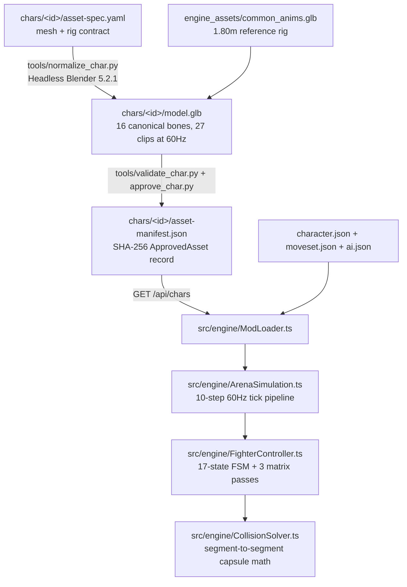

# Architecture

`arena-mugen-3d` separates offline asset preparation from the 60Hz runtime simulation. Offline Python scripts and headless Blender 5.2.1 normalize each fighter's mesh and bake the 27 shared animations into `chars/<id>/model.glb`. At runtime, `ArenaSimulation` advances match state on a fixed 60Hz integer tick, `FighterController` seeks bone poses and applies upper-body pitch aiming, and `CollisionSolver` tests analytical capsules attached to bone world matrices.

## Module responsibilities

| Module | Owns | Does not own |
|---|---|---|
| `tools/normalize_char.py` | Scaling meshes to `heightMeters`, snapping feet to `Y = 0`, aligning the 16 canonical bone sockets, scaling `Hips` translations by leg-span ratio $k_{\text{leg}}$ and baking NLA clips | Runtime state, hitboxes or gameplay rules |
| `tools/validate_char.py` | Fail-closed validation of `.glb` geometry, bone twist (`< 5°`), animation channels, JSON frame data and `ApprovedAsset` hashes | Modifying or repairing files |
| `src/engine/ModLoader.ts` | Fetching `/api/chars`, enforcing the `ApprovedAsset` invariant at load time and binding `character.json#boneMap` to `THREE.Object3D` nodes | Combat rules or frame stepping |
| `src/engine/FighterController.ts` | The 17-state fighter FSM, 8-tick input ring buffer, integer-tick `AnimationMixer` seeking, Layer 3 pitch/yaw aiming and Stage A/B throw pinning | Match flow, pushbox separation or simultaneous hit resolution |
| `src/engine/CollisionSolver.ts` | Zero-allocation `segmentSegmentDistSq` capsule distance checks, defender invulnerability rules and Phase A contact collection | Mutating fighter health, stun or state |
| `src/engine/ArenaSimulation.ts` | The 10-step 60Hz tick order, XZ pushbox and wall separation ($R \le 19.5\text{m}$), 3D projectiles, Phase B simultaneous trade/clash resolution and Best-of-3 round flow | DOM rendering or file I/O |
| `src/engine/CpuAiController.ts` | Delayed opponent perception ring buffer (`max(2, 20 - 2 * aiLevel)`), immediate self hit-confirm (`delay = 0`), single-shot triggers and the 180-tick anti-stalemate escalator | Direct state mutation; it emits `FighterInputFrame` records only |
| `src/engine/ArenaCamera.ts` | Height-adaptive look-at target, signed-angle anti-flip basis and cylindrical wall clamp ($R \le 19.2\text{m}$) | Gameplay simulation |
| `src/editor/FighterFactoryOverlay.ts` | Frame-by-frame timeline scrubbing, wireframe capsule inspection and saving edits to `/api/chars/:id/:file` | Offline Blender normalization |

## The 10-step 60Hz tick pipeline

`ArenaSimulation.stepOneTick()` executes ten deterministic steps on every tick (`dt = 1 / 60` seconds) and updates bone world matrices three times before collision detection:

| Step | Action | World matrix pass |
|---|---|---|
| 1 | Decrement `roundTimerTicks` and `hitstopFrames`, sample `CpuAiController` and advance `FighterController.stepTimersAndInputs` | — |
| 2 | Integrate active move velocities and gravity (`FighterController.integrateVelocityAndGravity`) | — |
| 3 | Solve fighter-vs-fighter XZ root pushbox separation and clamp roots to the $R \le 19.5\text{m}$ arena wall with corner residual transfer | — |
| 4 | Restore Pass-1 un-pitched bone quaternions and seek `mixer.setTime((currentAnimFrame + 0.001) / 60.0)` | **Pass 1** (`root.updateMatrixWorld(true)`) |
| 4b | Snapshot both fighters' un-pitched hurtbox centers and Layer 3 shoulder/hip pivots into `pass1Snapshot` | — |
| 5 | Apply Layer 3 upper-body pitch (`[-55°, +40°]`) and limb yaw (`[-25°, +25°]`) in parent-bone local space against `opponent.pass1Snapshot` | **Pass 2** (`root.updateMatrixWorld(true)`) |
| 6 | Pin `THROWN` victim's `chest` socket to attacker's post-pitch `hand_r` socket and clamp victim root to `Y >= 0.0` | **Pass 3** (`root.updateMatrixWorld(true)`) |
| 7 | Spawn new projectiles at post-pitch sockets and advance active 3D projectiles | — |
| 8 | Phase A read-only contact snapshot (`CollisionSolver.collectPendingFighterHits`) | — |
| 9 | Phase B simultaneous resolution (throw clashes, strike-vs-throw priority, trades, blocks, super armor, damage proration and state transitions) | — |
| 10 | Update `ArenaCamera` framing and push post-tick fighter snapshots into the AI perception ring buffer | — |

## Multi-height animation and combat solver

Fighters from `1.15m` (`pip_brawler`) to `2.45m` (`tecton_grappler`) share one 27-clip animation library (`engine_assets/common_anims.glb`) through four layers:

1. **Layer 1 — Canonical 16-bone skeleton (`ArenaHumanoid_v1`):** Every normalized rig exposes 16 required sockets (`hips`, `spine`, `chest`, `head`, `upper_arm_l/r`, `forearm_l/r`, `hand_l/r`, `thigh_l/r`, `shin_l/r`, `foot_l/r`) aligned within `5°` of the `1.80m` reference rig's rest axes.
2. **Layer 2 — Offline NLA retargeting with leg-span hip scaling:** `tools/normalize_char.py` bakes all 27 clips on Blender frames `0..N` at `scene.render.fps = 60` (`export_optimize_animation_size = False`). `Hips` translation offsets from rest pose are scaled by the kinematic leg-span ratio $k_{\text{leg}} = L_{\text{char}} / L_{\text{ref}}$ so feet never slide or float across heights.
3. **Layer 3 — Runtime nearest-height-hurtbox pitch and yaw aiming:** During moves with `pitchTracking: true`, `FighterController.applyLayer3PitchAiming` selects the opponent hurtbox in `pass1Snapshot` whose height $Y_h$ is closest to the attacking limb's pivot height $Y_{\text{piv}}$. It computes pitch $\theta \in [-55^\circ, +40^\circ]$ and lateral yaw $\psi \in [-25^\circ, +25^\circ]$, transforms the world right axis $\hat{\mathbf{R}}_{\text{world}}$ into parent-bone local space via $Q_{\text{parent,world}}^{-1}$, and premultiplies `spine` ($0.4\theta$) and the attacking limb ($0.6\theta$ for arms, $1.0\theta$ for legs). Because Three.js `r186` `PropertyMixer.apply` skips writing `bone.quaternion` when two consecutive keyframes have identical values (`accu0 === accu1`), `seekBasePosePass1` restores the un-pitched Pass-1 quaternions before calling `mixer.setTime`.
4. **Layer 4 — Height-scaled capsules and clamped socket-pinned throws:** Hurtbox radii and offsets scale by $S_H = \operatorname{clamp}(H / 1.80, 0.75, 1.35)$, while hitbox radii and offsets floor at `1.0` ($S_{\text{hit}} = \operatorname{clamp}(H / 1.80, 1.00, 1.35)$) so short fighters retain usable reach. Throws latch $(\theta_{\text{grab}}, \psi_{\text{grab}})$ on the connect frame, translate the victim's root so `victim.chest` matches `attacker.hand_r`, and clamp `victim.position.y >= 0.0` so a short attacker grabbing a tall defender never pushes the defender's feet through the floor.

## Enforcement

Contracts are enforced by automated checks run by `npm test` and `npm run validate-chars`:

| Problem | Caught by |
|---|---|
| Missing bone socket, bone twist `>= 5°`, ungrounded mesh (`minY != 0`), height mismatch `> 0.02m` or missing/24Hz animation channels | `tools/validate_char.py` and `tests/validate_char.test.ts` |
| Tampered `model.glb`, mismatched `manifest_hash` or unapproved asset | `tools/validate_char.py` and `src/engine/ModLoader.ts` |
| Tall (`2.45m`) vs. short (`1.15m`) jab whiffing, throw pin drift `>= 0.02m` or 60Hz tick `p95 >= 16.6ms` | `tests/multi_height_combat.test.ts` |
| Port-order bias on simultaneous hits, infinite air juggles (`> 8` hits), `THROWN` softlocks or non-deterministic seeded ticks | `tests/state_machine_determinism.test.ts` |
| Path traversal, symlink escape, case-insensitive alias, `> 1 MiB` payload, `model.*` mutation via `PUT` or concurrent `/normalize` | `tests/vite_fs_middleware.test.ts` |
| Billable Meshy HTTP call on invalid `asset-spec.yaml` or duplicate task creation on retry | `tests/meshy_adapter_idempotency.test.ts` and `tools/tests/test_pipeline.py` |
| AI vs. AI stalemate (`> 240` ticks without a hit) or archetype failing to hold `preferredRangeMeters` (`< 60%`) | `tests/ai_watch_mode_matrix.test.ts` |
| YAML 1.1 coercion traps (`0.1.0` float coercion, `no`/`off` booleans, anchors, tabs) or broken Mermaid diagrams in spec | `tools/tests/test_pipeline.py`, `evidence/structure_check.py`, `evidence/spec_check.py`, `evidence/mermaid_parse.mjs` |

## Background

The [decision records](decisions/README.md) explain the larger architectural choices, and [`docs/3d_arena_mugen_spec.md`](3d_arena_mugen_spec.md) contains the full mathematical derivations and empirical benchmark tables.
